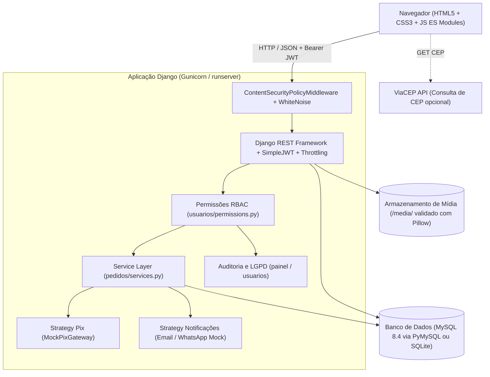
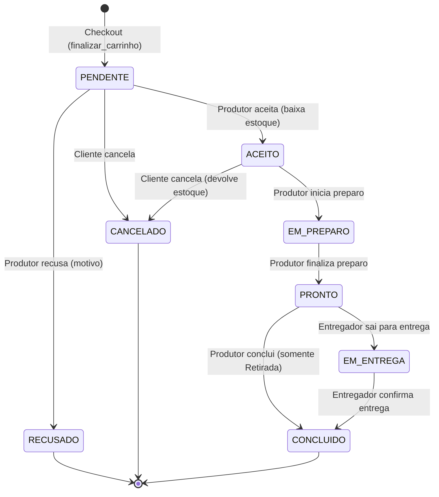

<p align="center">
  
</p>

<h1 align="center">Feira Virtual — Plataforma Digital para Agricultura Familiar</h1>

<p align="center">
  <strong>Documentação Técnica e Acadêmica — Engenharia de Software</strong><br />
  Plataforma web de comercialização direta entre produtores da agricultura familiar, consumidores e entregadores parceiros.
</p>

<p align="center">
  
  
  
  
  
  
  
  
</p>

---

## Sumário

1. [Apresentação da Ideia, Motivação, ODS e Aplicação de Padrões](#1-apresentação-da-ideia-motivação-ods-e-aplicação-de-padrões)
   - [1.1. Apresentação da Ideia](#11-apresentação-da-ideia)
   - [1.2. Motivação e Objetivos](#12-motivação-e-objetivos)
   - [1.3. Objetivos de Desenvolvimento Sustentável (ODS)](#13-objetivos-de-desenvolvimento-sustentável-ods)
   - [1.4. Visão Geral das Aplicações de Padrões de Projeto](#14-visão-geral-das-aplicações-de-padrões-de-projeto)
2. [Padrões de Projeto Aplicados](#2-padrões-de-projeto-aplicados)
   - [2.1. Service Layer](#21-service-layer-padrão-arquitetural--corporativo)
   - [2.2. Strategy e Factory Function](#22-strategy-e-factory-function-padrão-gof-comportamental)
   - [2.3. Adapter](#23-adapter-padrão-gof-estrutural)
   - [2.4. Template Method em RBAC](#24-template-method--hierarquia-rbac-padrão-gof-comportamental)
   - [2.5. Facade no Front-End](#25-facade--interceptador-http-no-front-end-padrão-estrutural)
   - [2.6. Organização Modular e Separação de Responsabilidades](#26-organização-modular-e-separação-de-responsabilidades-padrão-arquitetural)
3. [Acompanhamento do Projeto](#3-acompanhamento-do-projeto)
   - [3.1. Evolução Cronológica (Git)](#31-evolução-cronológica-baseada-no-histórico-do-git-dev)
   - [3.2. Tabela de Acompanhamento](#32-tabela-de-acompanhamento)
   - [3.3. Arquitetura, Tecnologias e Perfis](#33-arquitetura-tecnologias-e-funcionalidades-por-perfil)
4. [Conteinerizado](#4-conteinerizado)
5. [API com os Principais Requisitos](#5-api-com-os-principais-requisitos)
6. [Autenticação e Autorização](#6-autenticação-e-autorização)
7. [CI e Testes](#7-ci-e-testes)
8. [Front-End e Demonstração](#8-front-end-e-demonstração)
9. [Matriz Resumida dos Requisitos](#9-matriz-resumida-dos-requisitos)
10. [Estrutura dos Módulos e Considerações Finais](#10-estrutura-dos-módulos-e-considerações-finais)

---

## 1. Apresentação da Ideia, Motivação, ODS e Aplicação de Padrões

### 1.1. Apresentação da Ideia

A **Feira Virtual** é uma plataforma web desenvolvida no contexto da disciplina de Engenharia de Software com o propósito de viabilizar a **comercialização direta entre produtores da agricultura familiar e consumidores**, integrando também **entregadores parceiros** e **administradores** em um único ambiente digital.

Em vez de limitar-se a um catálogo estático, a aplicação estrutura o ciclo completo da venda agrícola:

- **Divulgação de produtos agrícolas** com preço, unidade de medida (`kg`, `g`, `L`, `ml`, `unidade`, `caixa`, `saco`, `maço`), estoque disponível e classificação por tipo de cultivo (orgânico certificado, agroecológico ou convencional).
- **Cadastro e gestão de propriedades rurais**, sujeitas à validação administrativa antes da exibição pública.
- **Comercialização direta** por meio de carrinho unificado com divisão automática de pedidos por produtor no checkout.
- **Gerenciamento de pedidos e controle transacional de estoque**, com baixa no aceite do produtor e estorno em casos de recusa ou cancelamento.
- **Organização logística das entregas**, com painel próprio para entregadores aceitarem pedidos prontos e acompanharem o trajeto até a conclusão.
- **Avaliação de produtos, produtores e avaliação recíproca de clientes**, vinculadas exclusivamente a pedidos concluídos.

### 1.2. Motivação e Objetivos

Pequenos produtores da agricultura familiar frequentemente enfrentam barreiras para divulgar sua produção e alcançar compradores locais de forma organizada. Entre os problemas que motivaram a criação da Feira Virtual, destacam-se:

- **Baixa visibilidade comercial** para produtores locais fora de feiras presenciais restritas.
- **Dependência de intermediários** no escoamento da produção, reduzindo o contato direto com o consumidor final.
- **Dificuldade de conexão entre campo e cidade**, tanto para o produtor divulgar disponibilidade atualizada quanto para o consumidor conhecer a origem e o tipo de cultivo dos alimentos.
- **Desorganização operacional** na gestão manual de pedidos, estoques e entregas.
- **Ausência de um ambiente digital integrado** que conecte venda, controle de estoque, entrega e retorno de qualidade.

A partir desse cenário, a solução foi concebida com os seguintes **objetivos**:

1. Dar visibilidade aos pequenos produtores rurais e às suas propriedades.
2. Facilitar a comercialização de produtos agrícolas em ambiente digital acessível.
3. Aproximar produtores e consumidores com transparência sobre origem, cultivo e avaliações.
4. Contribuir para reduzir a dependência de intermediários na comercialização.
5. Organizar pedidos, estoques e processos de entrega de forma consistente e rastreável.
6. Incentivar o comércio local e a agricultura familiar por meio da tecnologia.

> **Nota metodológica:** por tratar-se de um projeto acadêmico, benefícios socioeconômicos como redução efetiva de intermediários, elevação de renda ou redução de perdas de alimentos são apresentados como **objetivos e contribuições potenciais da proposta**, não como impactos empíricos já comprovados.

### 1.3. Objetivos de Desenvolvimento Sustentável (ODS)

A proposta da Feira Virtual alinha-se à **Agenda 2030 da Organização das Nações Unidas (ONU)**, relacionando suas funcionalidades reais a três Objetivos de Desenvolvimento Sustentável documentados pela [ONU Brasil](https://brasil.un.org/pt-br/sdgs):

<table>
  <thead>
    <tr>
      <th width="130">Ícone</th>
      <th>Objetivo e Meta de Referência (ONU Brasil)</th>
      <th>Relação com as Funcionalidades Reais da Feira Virtual</th>
    </tr>
  </thead>
  <tbody>
    <tr>
      <td align="center">
        <a href="https://brasil.un.org/pt-br/sdgs/2">
          
        </a>
      </td>
      <td>
        <strong><a href="https://brasil.un.org/pt-br/sdgs/2">ODS 2 — Fome Zero e Agricultura Sustentável</a></strong><br />
        <em>Meta 2.3:</em> dobrar a produtividade agrícola e a renda dos pequenos produtores de alimentos — em especial agricultores familiares —, inclusive por meio de acesso seguro a mercados e oportunidades de agregação de valor.
      </td>
      <td>
        A vitrine pública de produtores aprovados (<code>GET /api/produtores/</code>), o cadastro de propriedades (<code>PerfilProdutor</code>) e o catálogo de venda direta (<code>GET /api/produtos/</code>) oferecem um canal digital para ampliar a visibilidade e facilitar o acesso ao mercado por pequenos agricultores.
      </td>
    </tr>
    <tr>
      <td align="center">
        <a href="https://brasil.un.org/pt-br/sdgs/8">
          
        </a>
      </td>
      <td>
        <strong><a href="https://brasil.un.org/pt-br/sdgs/8">ODS 8 — Trabalho Decente e Crescimento Econômico</a></strong><br />
        <em>Meta 8.3:</em> promover atividades produtivas, geração de trabalho decente, empreendedorismo, criatividade, inovação e o fortalecimento de micro e pequenos empreendimentos.
      </td>
      <td>
        Os painéis dedicados de Produtor Rural (gestão de catálogo, pedidos e resumo de vendas em <code>/api/produtor/pedidos/resumo/</code> e <code>/vendas/</code>) e de Entregador (gestão e extrato de entregas em <code>/api/entregas/</code>) apoiam a organização do trabalho local e podem fomentar oportunidades econômicas na cadeia curta.
      </td>
    </tr>
    <tr>
      <td align="center">
        <a href="https://brasil.un.org/pt-br/sdgs/12">
          
        </a>
      </td>
      <td>
        <strong><a href="https://brasil.un.org/pt-br/sdgs/12">ODS 12 — Consumo e Produção Responsáveis</a></strong><br />
        <em>Meta 12.3:</em> reduzir o desperdício de alimentos nos níveis de varejo e do consumidor e reduzir perdas ao longo das cadeias de produção e abastecimento.
      </td>
      <td>
        A classificação explícita por tipo de cultivo (<code>ORGANICO_CERTIFICADO</code>, <code>AGROECOLOGICO</code> e <code>CONVENCIONAL</code>), a transparência de origem e o controle rigoroso de estoque/pedidos sob demanda (<code>pedidos/services.py</code>) favorecem uma comercialização mais organizada e consciente. <strong>Ressalva explícita:</strong> o sistema não mede diretamente a redução de desperdício ou de perdas pós-colheita.
      </td>
    </tr>
  </tbody>
</table>

> **Aviso de uso dos ícones (Diretrizes da ONU):** os ícones dos ODS são empregados estritamente com finalidade acadêmica e informativa, segundo as orientações da [ONU Brasil](https://brasil.un.org/pt-br/node/110468). A Feira Virtual é um projeto universitário independente e não possui vínculo institucional nem endosso oficial da ONU.

### 1.4. Visão Geral das Aplicações de Padrões de Projeto

Para sustentar esses objetivos com manutenibilidade, segurança e extensibilidade, a implementação aplicou padrões de projeto e decisões arquiteturais concretas — incluindo **Service Layer** para isolar a lógica transacional de pedidos/estoque, **Strategy** para abstrair pagamento Pix e canais de notificação, **Adapter** para compatibilizar o driver `PyMySQL` ao Django, **Template Method** na autorização RBAC, **Facade** no cliente HTTP com renovação JWT e **Monólito Modular** por domínio — detalhados com evidências diretas do código na [Seção 2](#2-padrões-de-projeto-aplicados).

---

## 2. Padrões de Projeto Aplicados

Para manter precisão conceitual em Engenharia de Software, as decisões estruturais da Feira Virtual são distinguidas em três categorias:

- **Padrões de Projeto GoF (Gang of Four):** `Strategy`, `Adapter` e `Template Method`.
- **Padrões Arquiteturais / Corporativos:** `Service Layer`, `Facade` (API Client) e `Monólito Modular`.
- **Boas Práticas de Engenharia de Software:** *snapshot* imutável em `ItemPedido`, *soft delete* com `LogAuditoria`, proteção de concorrência com `select_for_update()` e middleware CSP (`config/middleware.py`).

### 2.1. Service Layer (Padrão Arquitetural / Corporativo)

| Informação | Descrição |
|---|---|
| **Padrão** | Service Layer (Camada de Serviços) |
| **Objetivo** | Evitar que regras de negócio complexas, controle transacional e validações de domínio fiquem acoplados ou duplicados nas views HTTP e nos serializers. |
| **Aplicação** | Centraliza a finalização do carrinho, a divisão automática em um pedido por produtor, a validação de pagamento, o controle transacional de estoque (baixa e estorno) e a máquina de estados de pedidos. |
| **Evidência** | [`pedidos/services.py`](pedidos/services.py): `finalizar_carrinho()`, `mudar_status()`, `validar_pagamento()`, `_baixar_estoque()`, `_devolver_estoque()`, `_registrar()` e `TRANSICOES`; consumidos por `PedidoClienteViewSet`, `PedidoProdutorViewSet` e `EntregaViewSet` em `pedidos/views.py`. |
| **Benefícios** | Views mais enxutas, reutilização consistente das mesmas regras para Cliente, Produtor e Entregador, atomicidade com `@transaction.atomic` + `select_for_update()` e alta testabilidade. |

### 2.2. Strategy e Factory Function (Padrão GoF Comportamental)

| Informação | Descrição |
|---|---|
| **Padrão** | Strategy (com abstração de provedores, função fábrica e orquestrador) |
| **Objetivo** | Desacoplar as regras de pedido das implementações concretas de cobrança Pix e de envio de notificações, permitindo trocar ou adicionar provedores sem alterar o núcleo do sistema. |
| **Aplicação** | `GatewayPixBase` define o contrato (`gerar_cobranca()` e `validar_assinatura_webhook()`), implementado por `MockPixGateway` e resolvido por `obter_gateway_pix()`. Em notificações, `NotificadorBase` define `notificar()`, com implementações `NotificadorEmail` e `NotificadorWhatsApp` executadas por `CentralNotificacoes.disparar()`. |
| **Evidência** | [`pedidos/pix.py`](pedidos/pix.py) (`GatewayPixBase`, `MockPixGateway`, `obter_gateway_pix()`) e [`pedidos/notificacoes.py`](pedidos/notificacoes.py) (`NotificadorBase`, `NotificadorEmail`, `NotificadorWhatsApp`, `CentralNotificacoes`). |
| **Benefícios** | Facilita futuras integrações com provedores externos sem impactar `pedidos/services.py` nem `pedidos/views.py`, além de isolar eventuais falhas de um canal de notificação sem interromper os demais. |

> **Transparência sobre simulações:** `MockPixGateway` é uma implementação **simulada** (`"simulado": True`) para testes e ambiente local (com validação HMAC-SHA256 no webhook), e `NotificadorWhatsApp` apenas registra log estruturado (`[WHATSAPP MOCK]`). `NotificadorEmail` utiliza `console.EmailBackend` em dev (com suporte a SMTP via variáveis `EMAIL_*`). **Não há integração financeira ou de WhatsApp real ativa.**

### 2.3. Adapter (Padrão GoF Estrutural)

| Informação | Descrição |
|---|---|
| **Padrão** | Adapter (Adaptador) |
| **Objetivo** | Compatibilizar o driver Python puro `PyMySQL` com a interface `MySQLdb` esperada internamente pelo backend `django.db.backends.mysql` do Django. |
| **Aplicação** | Na inicialização do módulo `config`, o projeto define `pymysql.version_info` e executa `pymysql.install_as_MySQLdb()`, permitindo conectar ao MySQL 8.4 sem compilar bibliotecas nativas em C (`mysqlclient` / `gcc`). |
| **Evidência** | [`config/__init__.py`](config/__init__.py) (`pymysql.install_as_MySQLdb()`) e [`entrypoint.sh`](entrypoint.sh). |
| **Benefícios** | Build Docker mais simples e leve (`python:3.12-slim` sem compilador C) e troca transparente entre SQLite e MySQL via variável `DB_ENGINE`. |

### 2.4. Template Method / Hierarquia RBAC (Padrão GoF Comportamental)

| Informação | Descrição |
|---|---|
| **Padrão** | Template Method (aplicado à autorização por perfil no DRF) |
| **Objetivo** | Padronizar a checagem de autenticação e tipo de usuário em todos os endpoints sem repetir lógica condicional nas views. |
| **Aplicação** | A classe base `_PorTipo` implementa o fluxo comum em `has_permission()`, delegando às subclasses apenas a definição do atributo `tipo`. `AdminEscreveTodosLeem` complementa o modelo para recursos de leitura pública e escrita administrativa. |
| **Evidência** | [`usuarios/permissions.py`](usuarios/permissions.py): `_PorTipo`, `EhCliente`, `EhProdutor`, `EhEntregador`, `EhAdmin` e `AdminEscreveTodosLeem`. |
| **Benefícios** | Controle de acesso declarativo por ViewSet/APIView, reduzindo risco de falhas de permissão e facilitando auditoria. |

### 2.5. Facade / Interceptador HTTP no Front-End (Padrão Estrutural)

| Informação | Descrição |
|---|---|
| **Padrão** | Facade (Cliente HTTP centralizado no frontend) |
| **Objetivo** | Encapsular o envio de requisições autenticadas com Bearer JWT, a renovação automática de tokens expirados (`401`) com enfileiramento de chamadas simultâneas e o tratamento uniforme de erros. |
| **Aplicação** | Todos os módulos de interface (`auth.js`, `products.js`, `cart.js`, `orders.js`, `producer.js`, `delivery.js`, `admin.js`) consomem a API através de `apiFetch()`, que coordena `refreshAccessToken()` e dispara eventos globais (`fv:loading`, `fv:auth-expired`). |
| **Evidência** | [`frontend/js/api.js`](frontend/js/api.js): `apiFetch()`, `refreshAccessToken()`, `processQueue()`, `tokens` e `parseError()`. |
| **Benefícios** | Elimina duplicação de autenticação/tratamento de erro nos 8 módulos de tela e previne condições de corrida na renovação do token. |

### 2.6. Organização Modular e Separação de Responsabilidades (Padrão Arquitetural)

| Informação | Descrição |
|---|---|
| **Padrão** | Monólito Modular (Separação de Responsabilidades por Domínio) |
| **Objetivo** | Estruturar a aplicação com fronteiras nítidas entre domínios de negócio, equilibrando coesão arquitetural e simplicidade operacional. |
| **Aplicação** | O backend divide-se em cinco apps Django de domínio (`usuarios`, `catalogo`, `pedidos`, `avaliacoes`, `painel`) e um núcleo de configuração (`config`), enquanto a interface é organizada em ES Modules desacoplados (`frontend/`). |
| **Evidência** | Diretórios `config/`, `usuarios/`, `catalogo/`, `pedidos/`, `avaliacoes/`, `painel/` e `frontend/js/`. |
| **Benefícios** | Alta coesão por domínio, fácil localização de código/testes e manutenção evolutiva simplificada. |

| Módulo | Responsabilidade Principal |
|---|---|
| `config/` | Configurações (`settings.py`), roteamento raiz (`urls.py`), adapter PyMySQL (`__init__.py`), middleware CSP (`middleware.py`) e validação binária de uploads (`validators.py`). |
| `usuarios/` | Modelo `Usuario`, perfis 1:1 (`PerfilProdutor`, `PerfilEntregador`), `Endereco`, autenticação JWT, recuperação de senha, LGPD, RBAC e `seed_demo`. |
| `catalogo/` | `Categoria`, `Produto` (estoque, tipo de produção e moderação), vitrine de produtores aprovados, busca/filtros e estatísticas públicas. |
| `pedidos/` | `Carrinho`, `ItemCarrinho`, `Pedido`, `ItemPedido` (snapshot), `HistoricoStatus`, `services.py`, `pix.py`, `notificacoes.py` e entregas. |
| `avaliacoes/` | `Avaliacao` (produto e produtor), `AvaliacaoCliente` (avaliação recíproca do produtor ao cliente) e `Reclamacao`. |
| `painel/` | Moderação administrativa, soft delete, indicadores gerenciais e trilha `LogAuditoria`. |
| `frontend/` | HTML5, CSS3 (tokens + Light/Dark mode), 10 arquivos JS ES Modules (`main.js` + `js/*.js`) e ativos locais (`assets/`). |

---

## 3. Acompanhamento do Projeto

O desenvolvimento da Feira Virtual foi conduzido de forma incremental e rastreável por meio do **Git**, com separação entre a branch `main` e a branch de desenvolvimento `dev` (24 commits registrados entre `06/11/2026` e `21/11/2026`).

### 3.1. Evolução Cronológica Baseada no Histórico do Git (`dev`)

1. **Base da API, modelagem inicial e regras de negócio (`cc3d5c0`, 06/11/2026):** criação dos cinco apps Django, modelos relacionais, migrações iniciais, serializers, permissões RBAC, camada `pedidos/services.py` e primeiros testes de fluxo.
2. **Integração Front-End, suporte híbrido SQLite/MySQL e Docker (`bd7c0dc`, 13/11/2026):** interface servida diretamente pelo Django, upload de imagens, alternância SQLite/MySQL via `.env` e criação de `Dockerfile`, `docker-compose.yml` e `entrypoint.sh`.
3. **Hardening de segurança, identidade visual, modularização JS e testes (`bb472bb`, 19/11/2026):** middleware CSP, throttles por escopo, validação Pillow, `seed_demo`, `LogAuditoria`, LGPD, `MockPixGateway`, `CentralNotificacoes`, paleta oficial, divisão do frontend em ES Modules (`frontend/js/`) e ampliação da suíte de testes.
4. **Painéis dedicados, avaliações e refinamentos funcionais (`d1aa17a` a `e78839f`, 20/11/2026):** taxa de entrega definida exclusivamente no servidor, endurecimento do webhook Pix, proteção `ProtectedError` em categorias, resumo de endereço ao entregador antes do aceite, painéis próprios para Produtor Rural e Entregador, avaliações por compra (incluindo avaliação recíproca de clientes) e gestão administrativa com soft delete.
5. **Correções de revisão técnica (`c2d2ecb`, 21/11/2026):** proteção contra *Path Traversal* em `frontend_assets_view`, separação do campo `oculto_moderacao`, normalização de `txid` no webhook Pix, transição obrigatória `PRONTO → EM_ENTREGA → CONCLUIDO`, compatibilização de `UniqueConstraint` com MySQL 8.4, ajustes de Docker, promoção do Admin para workspace de tela cheia, diferenciação da Home para cliente logado, sprite SVG local, paginação nas listagens e ampliação para 42 testes automatizados.

### 3.2. Tabela de Acompanhamento

| Etapa | Descrição | Situação Real (evidenciada no repositório) |
|---|---|---|
| **Planejamento e Modelagem** | Definição da proposta, perfis, entidades, constraints e migrações (`usuarios`, `catalogo`, `pedidos`, `avaliacoes`, `painel`) | **Concluída** — modelos e migrações íntegros (`makemigrations --check --dry-run` sem pendências). |
| **Backend (API e Regras de Negócio)** | API REST em DRF, camada `pedidos/services.py`, estoque transacional, entregas, avaliações, LGPD, moderação e OpenAPI | **Concluída** — endpoints funcionais e schema OpenAPI validado. |
| **Autenticação e Autorização** | JWT com SimpleJWT (`access`/`refresh`/`blacklist`), throttles, recuperação de senha e permissões RBAC | **Concluída** — validada por testes de login, logout, permissões e isolamento de dados. |
| **Front-End** | Interface responsiva em HTML5, CSS3 e ES Modules com workspaces por perfil, Light/Dark mode e acessibilidade | **Concluída** — 10 módulos JS + sprite SVG local servidos sob CSP estrita. |
| **Integração Front-End e API** | Comunicação HTTP/JSON via `frontend/js/api.js` com refresh automático de JWT e paginação | **Concluída** — fluxos completos dos 4 perfis integrados à API real. |
| **Containerização** | `Dockerfile` não-root, `docker-compose.yml` (Django + MySQL 8.4) e `entrypoint.sh` | **Concluída (configurada)** — arquivos prontos e revisados para execução em ambiente com Docker. |
| **Testes Automatizados** | 42 métodos de teste distribuídos nos 5 módulos (`*/tests.py`) | **Concluída e validada** — 42/42 aprovados via `python manage.py test`. |
| **Integração Contínua (CI)** | Workflow automatizado em `.github/workflows/ci.yml` | **Pendente na branch `dev`** — constou em commits anteriores da `main` (`e5df5f2`, `e056968`), mas não existe atualmente na `dev`. |

O histórico semântico de commits (`feat:`, `fix:`, `security:`, `style:`, `docs:`) e o isolamento em branches permitiram auditar correções, acompanhar a evolução incremental das entregas e manter rastreabilidade técnica ao longo de toda a disciplina.

### 3.3. Arquitetura, Tecnologias e Funcionalidades por Perfil



**Stack tecnológica (`requirements.txt`, `requirements-dev.txt` e `Dockerfile`):** Python 3.12 · Django (`>=5.2,<7`; `6.1.3`) · DRF (`3.18.3`) · SimpleJWT (com `token_blacklist`) · `django-filter` · `django-cors-headers` · `drf-spectacular` · `PyMySQL` · `cryptography` · `Pillow` · `WhiteNoise` · `Gunicorn` · MySQL 8.4 / SQLite · HTML5, CSS3 e JavaScript ES Modules.

| Perfil | Principais Funcionalidades Implementadas |
|---|---|
| **Cliente** | Catálogo paginado com busca/filtros, vitrine de produtores, carrinho persistido, checkout multi-produtor (entrega/retirada; Pix simulado, cartão ou dinheiro), histórico e timeline de pedidos, cancelamento com estorno de estoque, CRUD de endereços (ViaCEP), avaliações de produtos/produtores, reclamações e direitos LGPD. |
| **Produtor Rural** | Cadastro de propriedade (aprovação admin), workspace dedicado, CRUD de produtos com foto/estoque/cultivo, resumo e relatório de vendas, aceite/recusa e avanço de pedidos, avaliação recíproca de clientes e gestão de formas de pagamento aceitas. |
| **Entregador** | Workspace dedicado sem catálogo de compras, lista de entregas disponíveis (endereço resumido antes do aceite), aceite atômico, sequência obrigatória `EM_ENTREGA → CONCLUIDO`, extrato de entregas e edição de dados do veículo. |
| **Administrador** | Workspace dedicado abrindo no Dashboard de Indicadores e fila de pendências, aprovação/suspensão/soft delete de produtores e usuários, moderação independente de produtos (`oculto_moderacao`), gestão de categorias (`ProtectedError`), pedidos, reclamações, avaliações e `LogAuditoria`. |

---

## 4. Conteinerizado

A Feira Virtual foi preparada para execução reproduzível em containers, garantindo padronização do ambiente, isolamento entre aplicação e banco de dados, portabilidade e facilidade de implantação.

### Componentes da Containerização

- **[`Dockerfile`](Dockerfile):** baseado em `python:3.12-slim`, cria o usuário sem privilégios administrativos `appuser` (com `HOME=/home/appuser` gravável para o Gunicorn), instala `requirements.txt` sem compilador C (`PyMySQL`), copia o código com `--chown=appuser:appgroup`, coleta estáticos via WhiteNoise no build, define `HEALTHCHECK` sobre `/api/health/` usando Python stdlib (sem `curl`) e inicia com `gunicorn config.wsgi:application --bind 0.0.0.0:8000 --workers 3 --timeout 60`.
- **[`docker-compose.yml`](docker-compose.yml):** orquestra dois serviços conectados em rede interna:
  - **`db` (`mysql:8.4`):** cria o banco `feira_virtual`, persiste dados no volume `mysql_data`, restringe a porta a `127.0.0.1:3306:3306` e usa `healthcheck` com `MYSQL_PWD` (sem expor senha na linha de comando).
  - **`web`:** depende de `db` com `condition: service_healthy`, conecta-se via `DB_HOST: db`, persiste uploads no volume `media_data`, expõe a porta `8000:8000` e recebe todas as variáveis de segurança, CORS, CSRF, e-mail, taxa de entrega e Pix.
- **[`entrypoint.sh`](entrypoint.sh):** aguarda ativamente o MySQL ficar disponível (até 30 tentativas), executa `python manage.py migrate --noinput` e inicia o servidor.

### Comandos de Execução

#### Execução com Docker Compose (Django + MySQL 8.4)

```bash
cp .env.example .env            # configure DJANGO_SECRET_KEY e senhas
docker compose up --build -d    # sobe MySQL 8.4 + Django e aplica migrações
docker compose ps               # verifica o status healthy dos serviços
```

*(Para subir apenas o banco MySQL em container e rodar o Django localmente: `docker compose up db -d`.)*

#### Execução Local Rápida com SQLite (Desenvolvimento)

```bash
python3 -m venv .venv && source .venv/bin/activate
pip install -r requirements.txt -r requirements-dev.txt
cp .env.example .env
export DJANGO_DEBUG=1
python manage.py migrate
python manage.py seed_demo      # opcional: cria contas e dados de demonstração
python manage.py runserver
```

URLs após iniciar: Interface (`http://127.0.0.1:8000/`), Swagger (`http://127.0.0.1:8000/api/docs/`), Schema OpenAPI (`http://127.0.0.1:8000/api/schema/`), Django Admin (`http://127.0.0.1:8000/admin/`) e Healthcheck (`http://127.0.0.1:8000/api/health/`).

#### MySQL Local (sem Docker) e Acesso Externo

- **MySQL local:** crie o banco `feira_virtual` (`utf8mb4_unicode_ci`) e o usuário dedicado, ajuste `DB_ENGINE=mysql`, `DB_NAME`, `DB_USER`, `DB_PASSWORD`, `DB_HOST=127.0.0.1`, `DB_PORT=3306` no `.env` e execute `python manage.py migrate`.
- **Acesso no celular:** com `runserver` ativo, execute `ngrok http 8000` ou `cloudflared tunnel --url http://localhost:8000` (`CSRF_TRUSTED_ORIGINS` já suporta esses domínios).

### Variáveis de Ambiente e Checklist de Produção

Modelo completo em [`.env.example`](.env.example) *(nunca versione `.env` nem chaves reais)*:

| Variável | Padrão | Finalidade |
|---|---|---|
| `DJANGO_DEBUG` | `0` | `1` apenas em desenvolvimento local. |
| `DJANGO_SECRET_KEY` | *(obrigatória com `DEBUG=0`)* | Chave criptográfica do Django (50+ caracteres aleatórios em produção). |
| `DJANGO_ALLOWED_HOSTS` | vazio (`*` em dev) | Hosts permitidos separados por vírgula. |
| `SECURE_SSL_REDIRECT` | `1` (`0` no compose local) | Ativa redirecionamento HTTPS, HSTS e cookies `Secure` atrás de TLS. |
| `DB_ENGINE` | `sqlite` | `sqlite` ou `mysql` (+ `DB_NAME`, `DB_USER`, `DB_PASSWORD`, `DB_HOST`, `DB_PORT`). |
| `ENABLE_SWAGGER` / `SHOW_DEMO_SHORTCUTS` | `0` / `0` | Libera Swagger sem admin / exibe atalhos demo no login (somente uso local). |
| `CORS_ALLOW_ALL_ORIGINS` / `CORS_ALLOWED_ORIGINS` | `0` (prod) / `1` (dev) | Controle de origens CORS. |
| `CSRF_TRUSTED_ORIGINS` | `localhost` + túneis | Origens confiáveis para proteção CSRF. |
| `EMAIL_BACKEND` / `EMAIL_*` | console (dev) / SMTP (prod) | Envio de e-mails de notificação e recuperação de senha. |
| `THROTTLE_*` | ver `.env.example` | Limites de taxa (`anon`, `user`, `login`, `registro`, `recuperar_senha`). |
| `PIX_WEBHOOK_SECRET` | vazio | Segredo HMAC-SHA256 do webhook Pix (obrigatório com `DEBUG=0`). |
| `TAXA_ENTREGA_PADRAO` | `0.00` | Taxa padrão de entrega definida exclusivamente no servidor. |

**Checklist de produção:** definir `DJANGO_DEBUG=0`, `DJANGO_SECRET_KEY` forte, `DB_ENGINE=mysql`, `PIX_WEBHOOK_SECRET`, SMTP em `EMAIL_*`, restringir `ALLOWED_HOSTS`/`CORS`/`CSRF`, ativar `SECURE_SSL_REDIRECT=1` atrás de proxy TLS e executar `collectstatic --no-input` + `check --deploy`.

---

## 5. API com os Principais Requisitos

A API REST utiliza **Django REST Framework** com troca de dados em **JSON** (e `multipart/form-data` para imagens validadas com Pillow), paginação (`PAGE_SIZE = 20`), busca (`SearchFilter`), filtros (`DjangoFilterBackend`), ordenação (`OrderingFilter`) e especificação OpenAPI 3 gerada pelo **`drf-spectacular`**.

- **Swagger UI:** `GET /api/docs/` e **Schema OpenAPI:** `GET /api/schema/` *(restritos a administradores por padrão; liberados com `ENABLE_SWAGGER=1`)*.
- **Comunicação Front-End ↔ Back-End:** todas as telas consomem `/api/...` na mesma origem com `Authorization: Bearer <access_token>`.

### Principais Endpoints por Módulo

| Módulo | Métodos e Endpoints | Responsabilidade |
|---|---|---|
| **Usuários** (`usuarios/urls.py`) | `POST /api/auth/registro/{cliente,produtor,entregador}/`<br>`POST /api/auth/{login,refresh,logout,recuperar-senha,redefinir-senha}/`<br>`GET/PATCH /api/perfil/` · `/perfil/{produtor,entregador}/`<br>`CRUD /api/enderecos/` · `GET /api/perfil/exportar-dados/` · `DELETE /api/perfil/excluir-conta/` | Cadastro multi-perfil, autenticação JWT, recuperação de senha, gestão de perfis, endereços e direitos LGPD (exclusão exige senha atual). |
| **Catálogo** (`catalogo/urls.py`) | `CRUD /api/categorias/` · `GET /api/produtos/` (`?search=`, `?categoria=`, `?tipo_producao=`, `?produtor=`, `?ordering=`, `?page=`)<br>`GET /api/produtores/` · `GET /api/estatisticas/`<br>`CRUD /api/produtor/produtos/` | Categorias ativas (`ProtectedError` na exclusão), vitrine de produtos/produtores aprovados (sem expor `chave_pix`) e gestão do catálogo e estoque do produtor. |
| **Pedidos e Pix** (`pedidos/urls.py`) | `GET/DELETE /api/carrinho/` · `POST/PATCH/DELETE /api/carrinho/itens/`<br>`POST/GET /api/pedidos/` · `POST /api/pedidos/{id}/cancelar/`<br>`GET /api/pedidos/{id}/pix/` · `POST /api/pedidos/pix/webhook/`<br>`GET/POST /api/produtor/pedidos/` (`/{id}/aceitar/`, `/recusar/`, `/status/`, `/vendas/`, `/resumo/`) | Carrinho, checkout multi-produtor, máquina de estados, controle transacional de estoque, cobrança Pix **simulada** (`MockPixGateway`) e webhook HMAC-SHA256. |
| **Entregas** (`pedidos/urls.py`) | `GET /api/entregas/?escopo=disponiveis\|minhas\|historico`<br>`GET /api/entregas/resumo/`<br>`POST /api/entregas/{id}/{aceitar,saiu-para-entrega,confirmar}/` | Listagem com endereço resumido antes do aceite, aceite atômico, sequência obrigatória `EM_ENTREGA → CONCLUIDO` e histórico do entregador. |
| **Avaliações** (`avaliacoes/urls.py`) | `GET/POST/PATCH/DELETE /api/avaliacoes/` · `GET /api/avaliacoes/minhas/`<br>`GET /api/produtor/avaliacoes/` · `GET/POST /api/produtor/avaliacoes-clientes/`<br>`GET/POST /api/reclamacoes/` | Avaliações de produtos e produtores vinculadas a pedidos concluídos, avaliação recíproca do produtor ao cliente e reclamações. |
| **Administração e Sistema** (`painel/urls.py`, `config/urls.py`) | `GET /api/admin/indicadores/`<br>`/api/admin/{usuarios,produtores,produtos,pedidos,reclamacoes,avaliacoes,avaliacoes-clientes}/`<br>`GET /api/config/` · `GET /api/health/` | Moderação de usuários, produtores, produtos (`oculto_moderacao`), pedidos, reclamações e avaliações com `LogAuditoria`; config pública e healthcheck. |

> **Serviços simulados:** `/api/pedidos/{id}/pix/` usa `MockPixGateway` (`"simulado": true`) e não realiza cobranças bancárias reais.

### Regras de Negócio e Máquina de Estados do Pedido

Controladas na camada de serviços [`pedidos/services.py`](pedidos/services.py):



1. **Separação por produtor:** um carrinho com itens de produtores diferentes gera um pedido independente por produtor.
2. **Estoque transacional:** validado no carrinho, no checkout (`select_for_update()`) e baixado no aceite do produtor; recusa ou cancelamento devolvem o estoque.
3. **Integridade de unidades e frete:** unidades inteiras (`UNIDADE`, `CAIXA`, `SACO`, `MACO`) rejeitam frações; a taxa de entrega é definida somente no servidor (`TAXA_ENTREGA_PADRAO`).
4. **Moderação e disponibilidade:** produtores novos entram como `PENDENTE`; produtos com `oculto_moderacao=True` ou de categoria inativa ficam bloqueados no catálogo, carrinho e checkout.
5. **Pagamento, avaliações e privacidade:** formas de pagamento são validadas contra o perfil do produtor; avaliações exigem pedido `CONCLUIDO` com `UniqueConstraint` compatível com SQLite e MySQL 8.4; `ItemPedido` preserva snapshot imutável de nome/preço/unidade; `chave_pix` não vaza na vitrine pública e o entregador vê apenas endereço resumido antes do aceite.

---

## 6. Autenticação e Autorização

A aplicação separa **autenticação** (identificar quem acessa a API) de **autorização** (validar quais recursos e operações o perfil pode executar).

### Mecanismo de Autenticação

- **Django REST Framework + SimpleJWT (`config/settings.py`):** `JWTAuthentication` como padrão, `ACCESS_TOKEN_LIFETIME = 1 hora`, `REFRESH_TOKEN_LIFETIME = 7 dias` e `rest_framework_simplejwt.token_blacklist` ativo.
- **Login, Logout e Recuperação de Senha (`usuarios/views.py`):**
  - `CustomTokenObtainPairView` aplica `LoginRateThrottle` (`10/minute`); cadastros e recuperação aplicam `5/minute`.
  - `LogoutView` valida se o `user_id` do refresh token pertence ao `request.user` antes de revogá-lo (`403 Forbidden` para tokens de terceiros).
  - `RecuperarSenhaView` envia link de redefinição com resposta neutra (evitando enumeração de contas) e `RedefinirSenhaView` aplica os validadores de senha do Django.
- **Política default-deny:** `DEFAULT_PERMISSION_CLASSES` exige `IsAuthenticated`; somente endpoints explicitamente liberados com `AllowAny` aceitam acesso anônimo.

### Mecanismo de Autorização (RBAC + Isolamento por Titular)

1. **Permissões personalizadas por papel ([`usuarios/permissions.py`](usuarios/permissions.py)):**

   ```python
   class _PorTipo(BasePermission):
       tipo = None
       def has_permission(self, request, view):
           u = request.user
           return bool(u and u.is_authenticated and u.tipo == self.tipo)

   class EhCliente(_PorTipo):     tipo = "CLIENTE"
   class EhProdutor(_PorTipo):    tipo = "PRODUTOR"
   class EhEntregador(_PorTipo):  tipo = "ENTREGADOR"
   class EhAdmin(_PorTipo):       tipo = "ADMIN"
   ```

   `AdminEscreveTodosLeem` protege categorias (leitura pública, escrita exclusiva de administradores).

2. **Isolamento de recursos (anti-IDOR):** além da classe de permissão, os ViewSets filtram `get_queryset()` pelo titular autenticado (`cliente=request.user`, `produtor__usuario=request.user`, `usuario=request.user`) e `pedidos/services.py` valida autoria/atribuição antes de qualquer transição de status.

| Perfil | Permissão DRF | Restrições Garantidas |
|---|---|---|
| **Cliente** | `EhCliente` | Acessa apenas carrinho, endereços, pedidos, avaliações e reclamações próprios; bloqueado em rotas de produtor, entregador e admin. |
| **Produtor Rural** | `EhProdutor` | Gerencia apenas própria propriedade, produtos e pedidos; não pode desfazer `oculto_moderacao` aplicado pelo admin. |
| **Entregador** | `EhEntregador` | Endereço resumido antes do aceite; só altera entregas atribuídas a si; impedido de pular `EM_ENTREGA`. |
| **Administrador** | `EhAdmin` / `AdminEscreveTodosLeem` | Modera contas, produtores, produtos, categorias, pedidos, reclamações e avaliações com trilha em `LogAuditoria`. |

---

## 7. CI e Testes

### Suíte de Testes Automatizados (42 métodos)

| Módulo | Testes | Cenários Validados |
|---|---|---|
| [`usuarios/tests.py`](usuarios/tests.py) | **10** | Cadastro de cliente/produtor (`PENDENTE`), upload de foto da propriedade, perfil, CRUD de endereços, exportação e exclusão LGPD (com exigência de senha e suspensão de produtor/produtos), bloqueio de logout com token alheio, bloqueio de *Path Traversal* em `/assets/`, `/api/config/` e link de recuperação de senha. |
| [`catalogo/tests.py`](catalogo/tests.py) | **9** | Permissões de categorias, tratamento de `ProtectedError`, visibilidade de categorias ativas, exposição de `aceita_pix` sem vazar `chave_pix`, filtros/busca, isolamento entre produtores, estatísticas públicas, header CSP/healthcheck e bloqueio de upload inválido. |
| [`pedidos/tests.py`](pedidos/tests.py) | **13** | Fluxo completo (carrinho → checkout → aceite → preparo → entrega → conclusão), cancelamento com devolução de estoque, logout/recuperação, múltiplos produtores gerando pedidos separados, Pix + webhook HMAC (e rejeição de segredo padrão em produção), taxa de entrega definida no servidor, recusa com motivo, validação de unidades no carrinho, endereço resumido antes do aceite, aceite duplicado/isolamento de entregas, resumo do produtor e bloqueio de categoria inativa. |
| [`avaliacoes/tests.py`](avaliacoes/tests.py) | **4** | Avaliação restrita a pedidos concluídos, isolamento de reclamações, avaliação recíproca do produtor ao cliente e histórico/autoria por pedido. |
| [`painel/tests.py`](painel/tests.py) | **6** | Restrição `EhAdmin`, bloqueio/reativação com `LogAuditoria`, aprovação/suspensão de produtor, moderação `oculto_moderacao` irreversível pelo produtor, moderação de reclamações e soft delete administrativo preservando histórico. |
| **Total** | **42** | **Cobertura integrada de requisitos funcionais, RBAC, concorrência, LGPD e segurança.** |

### Comandos Executados e Resultados Verificados

```bash
python manage.py check
python manage.py makemigrations --check --dry-run
python manage.py spectacular --validate --file /tmp/schema.yml
python manage.py test
```

Resultados obtidos na execução local sobre o código atual:

- `python manage.py check` → `System check identified no issues (0 silenced).`
- `python manage.py makemigrations --check --dry-run` → `No changes detected`
- `python manage.py spectacular --validate` → validado sem erros de schema.
- `python manage.py test` → **`Ran 42 tests in 207.263s — OK`** (42 aprovados, 0 falhas, 0 erros).

### Situação Real da Integração Contínua (CI)

Ao inspecionar a branch `dev`, verificou-se que **atualmente não há workflow configurado em `.github/workflows/`** (existiu um `.github/workflows/ci.yml` em commits anteriores da branch `main`, como `e5df5f2` e `e056968`, mas não está presente na `dev` atual). Assim, a automação de CI no GitHub Actions encontra-se **pendente na branch `dev`** e registrada como melhoria prioritária, sem alterar o código ou o pipeline nesta tarefa de documentação.

---

## 8. Front-End e Demonstração

### Tecnologias e Organização

O frontend é servido diretamente pelo Django sem etapas de build nem dependências externas (compatível com a CSP `script-src 'self'` de [`config/middleware.py`](config/middleware.py)):

- **HTML5 semântico** ([`frontend/index.html`](frontend/index.html)) com modais acessíveis (`role="dialog"`, `aria-modal="true"`) e regiões `aria-live`.
- **CSS3 com tokens** ([`frontend/style.css`](frontend/style.css)), layout responsivo, paleta extraída da logo oficial (regra 60-30-10, contraste WCAG 2.1 AA: verde `#246F11`, verde-escuro `#1B4312`, verde-claro `#67AE25`, laranja CTA `#F7990C` e fundos `#FAFAF8` / `#141712`), alternância **Light/Dark Mode** com troca automática da logo e suporte a `prefers-reduced-motion`.
- **JavaScript Vanilla em ES Modules:** coordenador [`frontend/main.js`](frontend/main.js) e 9 módulos em `frontend/js/` (`api.js`, `auth.js`, `products.js`, `cart.js`, `orders.js`, `producer.js`, `delivery.js`, `admin.js`, `ui.js`), acompanhados por sprite SVG local estilo Lucide ([`frontend/assets/icons.svg`](frontend/assets/icons.svg)).

### Principais Interfaces Implementadas

1. **Página Inicial diferenciada:** *Hero* e *Como funciona* para visitantes; banner compacto de boas-vindas com atalhos rápidos para clientes autenticados.
2. **Catálogo e Detalhes:** busca em tempo real, pills de categoria, filtro por tipo de produção, ordenação, paginação, modal de produto e vitrine/modal de produtores com avaliações paginadas.
3. **Carrinho (Drawer) e Checkout:** badge com contagem de itens distintos, focus trap, passos de quantidade conforme unidade, escolha de modalidade/endereço e validação de pagamento por produtor.
4. **Área do Cliente:** *Meus Pedidos* com timeline, modal Pix com QR Code SVG gerado localmente e copia-e-cola, CRUD de endereços (ViaCEP), avaliações, reclamações e modal acessível de exclusão de conta LGPD.
5. **Workspace do Produtor Rural:** KPIs, CRUD de produtos com preview e upload de foto, pedidos recebidos, relatório de vendas e avaliações recebidas/feitas.
6. **Workspace do Entregador:** acesso direto às entregas (sem catálogo de compras), entregas disponíveis, em andamento, histórico, ganhos e edição do veículo.
7. **Workspace Administrativo:** tela cheia abrindo no Dashboard de Indicadores e na Fila de Pendências, com navegação dedicada e botão para alternar à vitrine pública.

### Roteiro de Demonstração do Sistema

Para preparar dados de exemplo localmente (`DJANGO_DEBUG=1`), execute `python manage.py seed_demo` (ou `--reset` para recriar). O comando cria os quatro perfis de demonstração (`cliente_demo`, `produtor_demo`, `entregador_demo` e `admin`) e imprime as senhas temporárias no terminal (consultáveis também em [`usuarios/management/commands/seed_demo.py`](usuarios/management/commands/seed_demo.py); por segurança, senhas não são expostas neste README e o comando é bloqueado com `DEBUG=0`).

1. **Página inicial (Visitante):** abrir `http://127.0.0.1:8000/`, apresentar a proposta, alternar Light/Dark mode e mostrar a responsividade.
2. **Catálogo e Produtores:** pesquisar produtos, filtrar por categoria/cultivo, abrir detalhes do produto e consultar a vitrine de produtores.
3. **Operação como Cliente (`cliente_demo`):** entrar, cadastrar endereço com CEP, adicionar itens ao carrinho, concluir o checkout (entrega/retirada + Pix simulado) e acompanhar o pedido em *Meus Pedidos*.
4. **Gestão como Produtor (`produtor_demo`):** abrir o workspace do produtor, criar/editar produto, aceitar o pedido (com baixa de estoque) e avançá-lo até `Pronto`.
5. **Gestão de Entregas (`entregador_demo`):** acessar o painel do entregador, ver o pedido disponível com endereço resumido, aceitar (liberando o endereço completo), marcar *Saiu para entrega* e *Confirmar entrega*.
6. **Avaliações pós-compra:** retornar ao cliente para avaliar o produto e o produtor do pedido concluído (e opcionalmente demonstrar a avaliação recíproca feita pelo produtor).
7. **Administração (`admin`):** entrar no workspace administrativo, exibir o dashboard de indicadores, a fila de pendências, a moderação de produtos/produtores/usuários e o controle de categorias e reclamações.

### Evidências Visuais

Ativo gráfico oficial versionado em `frontend/assets/`:

<p align="center">
  
</p>

> **Pendência registrada:** o repositório já versiona os ativos oficiais da identidade visual (logos PNG/WebP light/dark, `og-image.png`, favicons PWA e `icons.svg`), porém ainda não possui capturas de tela das interfaces em execução versionadas (ex.: em `docs/screenshots/`).

---

## 9. Matriz Resumida dos Requisitos

| Requisito / Critério | Evidências no Projeto | Seção |
|---|---|---|
| **Apresentação da ideia, motivação e ODS** | Proposta da agricultura familiar, motivação/objetivos e alinhamento aos ODS 2 (Meta 2.3), ODS 8 (Meta 8.3) e ODS 12 (Meta 12.3) com fontes oficiais da ONU Brasil | [Seção 1](#1-apresentação-da-ideia-motivação-ods-e-aplicação-de-padrões) |
| **Padrões de projeto** | `Service Layer` (`pedidos/services.py`), `Strategy` (`pedidos/pix.py`, `pedidos/notificacoes.py`), `Adapter` (`config/__init__.py`), `Template Method` (`usuarios/permissions.py`), `Facade` (`frontend/js/api.js`) e Monólito Modular | [Seção 2](#2-padrões-de-projeto-aplicados) |
| **Acompanhamento do projeto** | Histórico real de 24 commits na branch `dev` (06/11/2026 a 21/11/2026), branches `main`/`dev`, tabela de etapas reais e diagrama de arquitetura | [Seção 3](#3-acompanhamento-do-projeto) |
| **Conteinerizado** | [`Dockerfile`](Dockerfile) (não-root, WhiteNoise, Gunicorn, `HEALTHCHECK`), [`docker-compose.yml`](docker-compose.yml) (Django + MySQL 8.4, volumes e rede interna) e [`entrypoint.sh`](entrypoint.sh) | [Seção 4](#4-conteinerizado) |
| **API com os principais requisitos** | API REST DRF cobrindo Usuários, Catálogo, Pedidos/Estoque, Entregas, Avaliações e Administração, com OpenAPI/Swagger (`drf-spectacular`) e regras de negócio no servidor | [Seção 5](#5-api-com-os-principais-requisitos) |
| **Autenticação e Autorização** | SimpleJWT (`access`/`refresh`/`blacklist`), throttles dedicados, recuperação de senha, RBAC em [`usuarios/permissions.py`](usuarios/permissions.py) e isolamento contra IDOR | [Seção 6](#6-autenticação-e-autorização) |
| **CI e Testes** | **42 testes automatizados aprovados** nos 5 apps + `check`, `makemigrations --check` e `spectacular --validate`; pendência transparente de `.github/workflows/ci.yml` na `dev` | [Seção 7](#7-ci-e-testes) |
| **Front-End e Demonstração** | Interface responsiva em HTML5/CSS3/ES Modules (`frontend/main.js` + `frontend/js/`), workspaces por perfil, Light/Dark mode, CSP estrita e roteiro prático de apresentação | [Seção 8](#8-front-end-e-demonstração) |

---

## 10. Estrutura dos Módulos e Considerações Finais

```text
feira_virtual/
├── config/                    # settings.py, urls.py, __init__.py (Adapter PyMySQL), middleware.py (CSP), validators.py
├── usuarios/                  # Perfis (Cliente/Produtor/Entregador/Admin), Endereco, JWT, permissions.py, LGPD e seed_demo
├── catalogo/                  # Categoria, Produto, vitrine de produtores aprovados, filtros e estatísticas
├── pedidos/                   # Carrinho, Pedido, ItemPedido, services.py, pix.py (Mock), notificacoes.py e entregas
├── avaliacoes/                # Avaliacao (produto/produtor), AvaliacaoCliente (recíproca) e Reclamacao
├── painel/                    # Moderação administrativa, indicadores gerenciais e LogAuditoria
├── frontend/                  # index.html, style.css, main.js, js/ (9 ES Modules) e assets/ (logos, icons.svg, PWA)
└── Dockerfile · docker-compose.yml · entrypoint.sh · requirements.txt · requirements-dev.txt · .env.example
```

### Considerações Finais e Pendências Conhecidas

A Feira Virtual consolida, em uma única aplicação verificável, modelagem relacional, arquitetura modular, padrões de projeto evidenciados no código, segurança da informação, controle de acesso por perfil, containerização e 42 testes automatizados voltados à comercialização direta da agricultura familiar.

Como pontos de evolução futura registrados de forma transparente, permanecem: (1) reintrodução do workflow `.github/workflows/ci.yml` na branch `dev`; (2) versionamento de capturas de tela reais das interfaces em execução; (3) substituição das estratégias simuladas de Pix (`MockPixGateway`) e WhatsApp (`NotificadorWhatsApp`) por provedores homologados em ambiente de produção; e (4) inclusão de arquivo `LICENSE` formal e testes automatizados E2E de interface.
