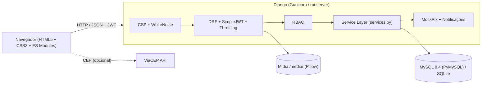

<p align="center">
  
</p>

<h1 align="center">Feira Virtual — Plataforma de Venda Direta</h1>

<p align="center">
  <strong>Disciplina:</strong> Engenharia de Software &nbsp;|&nbsp; <strong>Código:</strong> DCA3603<br />
  <strong>Integrantes:</strong> Débora Nicolly Araújo da Silva · Douglas Amon Passos dos Anjos · Caio de Miranda Silva · Paulo Guilherme Xavier da Silva
</p>

<p align="center">
  
  
  
  
  
  
  
</p>

**Sumário:** [1. Princípios](#1-princípios-de-projeto-e-engenharia-de-software) · [2. Proposta, Motivação e ODS](#2-apresentação-motivação-e-ods) · [3. Padrões de Projeto](#3-padrões-de-projeto-aplicados) · [4. Critérios de Avaliação](#4-critérios-de-avaliação-e-evidências) ([4.1 Docker](#41-projeto-conteinerizado) · [4.2 API](#42-api-com-os-principais-requisitos) · [4.3 Auth](#43-autenticação-e-autorização) · [4.4 Testes/CI](#44-ci-e-testes) · [4.5 Front-End](#45-front-end-e-demonstração)) · [5. Arquitetura e Diretórios](#5-arquitetura-e-diretórios) · [6. Execução Local e Variáveis](#6-execução-local-sem-docker-e-variáveis) · [7. Considerações Finais](#7-considerações-finais)

---

## 1. Princípios de Projeto e Engenharia de Software

| Princípio | Importância | Evidência na Feira Virtual |
|---|---|---|
| **Modularidade** | Fronteiras claras entre subdomínios. | 5 apps Django (`usuarios`, `catalogo`, `pedidos`, `avaliacoes`, `painel`) + `config` e 10 ES Modules (`frontend/`). |
| **Separação de responsabilidades** | Isola HTTP, validação e regras de negócio. | Views (`*/views.py`), serializers (`*/serializers.py`) e camada transacional em [`pedidos/services.py`](pedidos/services.py). |
| **Baixo acoplamento** | Facilita troca de provedores sem alterar o núcleo. | Contratos abstratos em `pedidos/pix.py` e `pedidos/notificacoes.py`; UI desacoplada via `/api/` (`api.js`). |
| **Alta coesão** | Agrupa modelos, rotas e testes do mesmo domínio. | Cada app concentra seus próprios `models.py`, `serializers.py`, `views.py`, `urls.py` e `tests.py`. |
| **Reutilização de código** | Evita duplicação com abstrações comuns. | Base `_PorTipo` (`usuarios/permissions.py`), `mudar_status()` (`services.py`), `apiFetch()` e `renderIcon()` (`frontend/js/`). |
| **Manutenibilidade** | Reduz risco de regressão em evoluções. | 42 testes automatizados, logs estruturados, `LogAuditoria` (`painel/models.py`) e histórico Git semântico. |
| **Segurança** | Protege dados e operações conforme o perfil. | RBAC + filtro anti-IDOR, CSP (`config/middleware.py`), anti-*Path Traversal* (`config/urls.py`), throttles, Pillow e LGPD. |
| **Escalabilidade** | Suporta crescimento de dados e tráfego. | Paginação (`PAGE_SIZE = 20`), índices, `select_related`/`prefetch_related`, Gunicorn, WhiteNoise e MySQL 8.4 *(mídia em `/media/` exigiria S3/R2 em múltiplas réplicas)*. |

---

## 2. Apresentação, Motivação e ODS

A **Feira Virtual** conecta **produtores da agricultura familiar**, **consumidores**, **entregadores parceiros** e **administradores** em um único ambiente web para venda direta — integrando catálogo, carrinho com separação automática por produtor, controle transacional de estoque, entregas, avaliações pós-compra e moderação.

- **Motivação:** enfrentar baixa visibilidade comercial de pequenos produtores, dependência de intermediários, distanciamento campo–cidade e desorganização manual de pedidos, estoques e entregas.
- **Objetivos:** viabilizar comercialização direta e transparente (preço, estoque, cultivo orgânico/agroecológico/convencional, formas de pagamento), organizar pedidos/entregas e oferecer workspaces específicos por perfil. *(Contribuições potenciais esperadas em escopo acadêmico, sem resultados empíricos comprovados.)*

### Relação com os ODS ([ONU Brasil — Agenda 2030](https://brasil.un.org/pt-br/sdgs))

| Ícone | ODS e Meta de Referência | Vínculo com as Funcionalidades Reais |
|---|---|---|
| <a href="https://brasil.un.org/pt-br/sdgs/2"></a> | **[ODS 2 — Fome Zero e Agricultura Sustentável](https://brasil.un.org/pt-br/sdgs/2)**<br />*Meta 2.3:* acesso a mercados e valorização de pequenos produtores. | Vitrine de produtores aprovados (`/api/produtores/`), `PerfilProdutor` e catálogo direto (`/api/produtos/`). |
| <a href="https://brasil.un.org/pt-br/sdgs/8"></a> | **[ODS 8 — Trabalho Decente e Crescimento Econômico](https://brasil.un.org/pt-br/sdgs/8)**<br />*Meta 8.3:* apoio a atividades produtivas e empreendedorismo local. | Painéis operacionais de Produtor Rural (`/api/produtor/pedidos/`) e Entregador (`/api/entregas/` e extrato). |
| <a href="https://brasil.un.org/pt-br/sdgs/12"></a> | **[ODS 12 — Consumo e Produção Responsáveis](https://brasil.un.org/pt-br/sdgs/12)**<br />*Meta 12.3:* redução do desperdício e perdas na cadeia alimentar. | Transparência de cultivo e estoque/pedidos sob demanda (`services.py`). *Limitação: não mede redução de desperdício.* |

> *Ícones utilizados apenas com finalidade acadêmica conforme diretrizes da [ONU Brasil](https://brasil.un.org/pt-br/node/110468), sem vínculo institucional com a ONU.*

---

## 3. Padrões de Projeto Aplicados

Distingue-se **Padrões GoF** (`Strategy`, `Adapter`, `Template Method`, `Facade`), **Padrão Arquitetural** (`Service Layer` sobre *Monólito Modular*) e **boas práticas** (snapshot `ItemPedido`, *soft delete* com `LogAuditoria`, `select_for_update()` e middleware CSP):

| Padrão | Tipo | Objetivo | Aplicação e Evidência | Benefícios |
|---|---|---|---|---|
| **Service Layer** | Arquitetural | Isolar regras de domínio e transações das views HTTP. | [`pedidos/services.py`](pedidos/services.py): `finalizar_carrinho()`, `mudar_status()`, `validar_pagamento()`, `_baixar_estoque()`, `_devolver_estoque()`, `TRANSICOES`. | Atomicidade (`@transaction.atomic` + `select_for_update()`) e reuso único entre perfis. |
| **Strategy** (+ Factory) | GoF Comportamental | Desacoplar pedidos dos provedores de pagamento Pix e notificações. | [`pedidos/pix.py`](pedidos/pix.py) (`GatewayPixBase`, `MockPixGateway`, `obter_gateway_pix()`) e [`pedidos/notificacoes.py`](pedidos/notificacoes.py) (`NotificadorBase`, `NotificadorEmail`, `NotificadorWhatsApp`, `CentralNotificacoes`). | Permite plugar gateways reais sem mexer no domínio e isola falhas por canal. |
| **Adapter** | GoF Estrutural | Compatibilizar `PyMySQL` com a interface `MySQLdb` do Django. | [`config/__init__.py`](config/__init__.py) (`pymysql.install_as_MySQLdb()`) e [`entrypoint.sh`](entrypoint.sh). | Elimina `gcc`/`mysqlclient` no Docker e alterna SQLite ↔ MySQL via `.env`. |
| **Template Method** | GoF Comportamental | Evitar repetição da verificação de perfil nas permissões DRF. | [`usuarios/permissions.py`](usuarios/permissions.py): `_PorTipo.has_permission()` herdado por `EhCliente`, `EhProdutor`, `EhEntregador` e `EhAdmin`. | Controle RBAC declarativo e uniforme. |
| **Facade** | GoF Estrutural | Centralizar Bearer JWT, fila de refresh `401` e parse de erros no JS. | [`frontend/js/api.js`](frontend/js/api.js): `apiFetch()`, `refreshAccessToken()`, `processQueue()`, `tokens`, `parseError()`. | Desacopla os 8 módulos de tela do HTTP e evita *race condition* no refresh. |

> **Simulações:** `MockPixGateway` (`"simulado": True`) e `NotificadorWhatsApp` (`[WHATSAPP MOCK]`) são simulados; `NotificadorEmail` usa `console.EmailBackend` em dev (SMTP configurável via `EMAIL_*`).

---

## 4. Critérios de Avaliação e Evidências

### 4.1. Projeto Conteinerizado

- **[`Dockerfile`](Dockerfile):** `python:3.12-slim`, usuário não-root `appuser` (`HOME=/home/appuser`), `PyMySQL` sem `gcc`, WhiteNoise (`collectstatic`), `HEALTHCHECK` em `/api/health/` e **Gunicorn** (`3 workers`).
- **[`docker-compose.yml`](docker-compose.yml) e [`entrypoint.sh`](entrypoint.sh):** orquestra `db` (**MySQL 8.4**, volume `mysql_data`, porta `127.0.0.1:3306:3306`, `healthcheck` com `MYSQL_PWD`) e `web` (`DB_HOST: db`, volume `media_data`, porta `8000:8000`), com espera ativa do banco e `migrate --noinput` no boot.

```bash
cp .env.example .env            # defina DJANGO_SECRET_KEY e senhas
docker compose up --build -d    # sobe MySQL 8.4 + Django e aplica migrações
docker compose ps               # valida saúde dos serviços (up db -d sobe só o banco)
docker compose logs -f web      # acompanha logs | docker compose down encerra mantendo volumes
```

### 4.2. API com os Principais Requisitos

API REST em **Django REST Framework** (JSON / `multipart` validado com Pillow, `PAGE_SIZE = 20`, busca, filtros e ordenação). Swagger UI em `http://127.0.0.1:8000/api/docs/` e schema em `/api/schema/` *(restritos a admin; `ENABLE_SWAGGER=1` libera localmente)*. Cobrança Pix em `/api/pedidos/{id}/pix/` é simulada (`MockPixGateway`, `"simulado": true`).

| Módulo | Principais Endpoints REST |
|---|---|
| **Usuários & LGPD** (`usuarios/urls.py`) | `POST /api/auth/registro/{cliente,produtor,entregador}/` · `POST /api/auth/{login,refresh,logout,recuperar-senha,redefinir-senha}/` · `GET/PATCH /api/perfil/` (`/produtor/`, `/entregador/`) · `CRUD /api/enderecos/` · `GET /api/perfil/exportar-dados/` · `DELETE /api/perfil/excluir-conta/` |
| **Catálogo** (`catalogo/urls.py`) | `CRUD /api/categorias/` · `GET /api/produtos/` (`?search=`, `?categoria=`, `?tipo_producao=`, `?produtor=`, `?ordering=`, `?page=`) · `GET /api/produtores/` · `GET /api/estatisticas/` · `CRUD /api/produtor/produtos/` |
| **Pedidos & Pix** (`pedidos/urls.py`) | `GET/DELETE /api/carrinho/` · `POST/PATCH/DELETE /api/carrinho/itens/` · `POST/GET /api/pedidos/` · `POST /api/pedidos/{id}/cancelar/` · `GET /api/pedidos/{id}/pix/` · `POST /api/pedidos/pix/webhook/` · `GET/POST /api/produtor/pedidos/` (`/{id}/aceitar/`, `/recusar/`, `/status/`, `/vendas/`, `/resumo/`) |
| **Entregas** (`pedidos/urls.py`) | `GET /api/entregas/?escopo=disponiveis\|minhas\|historico` · `GET /api/entregas/resumo/` · `POST /api/entregas/{id}/{aceitar,saiu-para-entrega,confirmar}/` |
| **Avaliações** (`avaliacoes/urls.py`) | `CRUD /api/avaliacoes/` · `GET /api/avaliacoes/minhas/` · `GET /api/produtor/avaliacoes/` · `GET/POST /api/produtor/avaliacoes-clientes/` · `GET/POST /api/reclamacoes/` |
| **Admin & Sistema** (`painel/urls.py`, `config/urls.py`) | `GET /api/admin/indicadores/` · `/api/admin/{usuarios,produtores,produtos,pedidos,reclamacoes,avaliacoes,avaliacoes-clientes}/` · `GET /api/config/` · `GET /api/health/` · `/api/schema/` · `/api/docs/` |

### 4.3. Autenticação e Autorização

- **Autenticação (`SimpleJWT`):** tokens `access` (`1h`) e `refresh` (`7d`), `token_blacklist`, throttles dedicados (`login`: `10/min`; `registro`/`recuperar_senha`: `5/min`), recuperação com resposta neutra e `LogoutView` validando posse do token (`403` para terceiros). `CsrfViewMiddleware` e cookies `HttpOnly`/`Secure` (`SECURE_SSL_REDIRECT=1`) protegem `SessionAuthentication` (Admin); no frontend ([`api.js`](frontend/js/api.js)), o JWT fica em `localStorage` sob CSP estrita (`script-src 'self'`) com `ROTATE_REFRESH_TOKENS = False` (migração para cookies `HttpOnly` e rotação mapeada como melhoria).
- **Autorização (RBAC + Anti-IDOR):** padrão *default-deny* (`IsAuthenticated`), classes [`usuarios/permissions.py`](usuarios/permissions.py) (`EhCliente`, `EhProdutor`, `EhEntregador`, `EhAdmin`, `AdminEscreveTodosLeem`) e `get_queryset()` filtrado pelo titular:

| Perfil | Permissões e Restrições |
|---|---|
| **Cliente** (`EhCliente`) | Compra, gerencia carrinho/endereços, acompanha/cancela próprios pedidos, avalia após conclusão e abre reclamações. |
| **Produtor Rural** (`EhProdutor`) | Gerencia propriedade, produtos, pedidos recebidos, vendas e avaliação recíproca; não reverte `oculto_moderacao`. |
| **Entregador** (`EhEntregador`) | Vê endereço resumido antes do aceite; segue `PRONTO → EM_ENTREGA → CONCLUIDO` apenas em entregas próprias. |
| **Administrador** (`EhAdmin`) | Gerencia usuários, aprova/suspende produtores, modera catálogo/reclamações/avaliações e audita via `LogAuditoria`. |

### 4.4. CI e Testes

**42 testes automatizados aprovados** (cobertura medida de **87%** via `coverage`): [`usuarios/tests.py`](usuarios/tests.py) (**10**), [`catalogo/tests.py`](catalogo/tests.py) (**9**), [`pedidos/tests.py`](pedidos/tests.py) (**13**), [`avaliacoes/tests.py`](avaliacoes/tests.py) (**4**) e [`painel/tests.py`](painel/tests.py) (**6**). Cobrem cadastros, RBAC, anti-IDOR, estoque transacional, Pix HMAC, entregas, avaliações recíprocas, LGPD, moderação, CSP e anti-*Path Traversal*.  
**CI:** não há `.github/workflows/ci.yml` presente na branch `dev` atual (existiu apenas em commits anteriores da `main`); automação no GitHub Actions está **pendente na `dev`**.

```bash
python manage.py check && python manage.py makemigrations --check --dry-run
python manage.py test -v 2
python manage.py spectacular --validate --file /tmp/schema.yml
DJANGO_DEBUG=0 DJANGO_SECRET_KEY='<chave-50+-caracteres>' DJANGO_ALLOWED_HOSTS=localhost SECURE_SSL_REDIRECT=1 python manage.py check --deploy
```

### 4.5. Front-End e Demonstração

- **Interface sem CDNs/build (`script-src 'self'`):** HTML5, CSS3 (paleta `#246F11` / `#1B4312` / `#67AE25` / `#F7990C` / `#FAFAF8` / `#141712`, Light/Dark Mode, `prefers-reduced-motion`, botões ≥ `44px`, *focus trap*, `Escape`, `aria-live`, toggle de senha), 10 ES Modules (`main.js` + `frontend/js/*.js`) e sprite SVG local (`frontend/assets/icons.svg`).
- **Roteiro com dados do RN (`python manage.py seed_demo` em `DEBUG=1`):** popula 6 produtores aprovados + 1 pendente do RN, 30 produtos públicos, 5 clientes, 3 entregadores, 20 pedidos e 26 avaliações (credenciais demo exibidas apenas no terminal para `cliente_demo`, `produtor_demo`, `entregador_demo` e `admin`):
  1. **Visitante (`/`):** alternar tema, buscar/filtrar catálogo e explorar produtores do RN.
  2. **Cliente (`cliente_demo`):** cadastrar endereço (ViaCEP), montar carrinho, concluir checkout (Pix simulado) e checar timeline em *Meus Pedidos*.
  3. **Produtor (`produtor_demo`):** abrir workspace próprio, aceitar pedido (baixa estoque) e avançar até `Pronto`.
  4. **Entregador (`entregador_demo`):** painel direto (sem catálogo), endereço resumido → aceitar entrega → *Saiu para entrega* → *Confirmar entrega*.
  5. **Avaliações e Admin (`admin`):** avaliar pedido concluído como cliente e demonstrar KPIs, fila de pendências e moderação no workspace Admin.

---

## 5. Arquitetura e Diretórios



```text
feira_virtual/
├── config/       # settings.py, urls.py, __init__.py (Adapter PyMySQL), middleware.py (CSP), validators.py
├── usuarios/     # Perfis (4 tipos), Endereco, permissions.py, LGPD, management/commands/seed_demo.py
├── catalogo/     # Categoria, Produto, vitrine pública e estatísticas
├── pedidos/      # Carrinho, Pedido, ItemPedido (snapshot), services.py, pix.py (Mock), notificacoes.py, entregas
├── avaliacoes/   # Avaliacao (produto/produtor), AvaliacaoCliente (recíproca) e Reclamacao
├── painel/       # Moderação admin, indicadores e LogAuditoria
├── frontend/     # index.html, style.css, main.js, js/ (9 ES Modules) e assets/ (logos, icons.svg, og-image.png)
└── Dockerfile · docker-compose.yml · entrypoint.sh · requirements.txt · requirements-dev.txt · .env.example
```

**Stack:** Python 3.12 · Django 6.1 · DRF 3.18 · SimpleJWT · `django-filter` · `django-cors-headers` · `drf-spectacular` · PyMySQL / MySQL 8.4 / SQLite · Pillow · WhiteNoise · Gunicorn · Docker Compose · `coverage` / `pytest-django` / `ruff`.

---

## 6. Execução Local (sem Docker) e Variáveis

**Pré-requisitos:** Python 3.12+, `pip`, `venv` (local) ou Docker Engine + Compose v2 (containers).

```bash
python3 -m venv .venv && source .venv/bin/activate
pip install -r requirements.txt -r requirements-dev.txt
cp .env.example .env && export DJANGO_DEBUG=1
python manage.py migrate && python manage.py seed_demo && python manage.py runserver
```

- **URLs locais:** Interface `http://127.0.0.1:8000/` · Swagger `/api/docs/` · Admin `/admin/` · Health `/api/health/`.
- **Acesso móvel / MySQL local:** use `ngrok http 8000` (ou `cloudflared tunnel`) para celular; ou ajuste `DB_ENGINE=mysql` e `DB_*` no `.env` para MySQL local.
- **Principais variáveis ([`.env.example`](.env.example)):** `DJANGO_DEBUG`, `DJANGO_SECRET_KEY`, `DJANGO_ALLOWED_HOSTS`, `SECURE_SSL_REDIRECT`, `DB_ENGINE`/`DB_*`, `ENABLE_SWAGGER`, `SHOW_DEMO_SHORTCUTS`, `CORS_*`, `CSRF_TRUSTED_ORIGINS`, `EMAIL_*`, `THROTTLE_*`, `PIX_WEBHOOK_SECRET`, `TAXA_ENTREGA_PADRAO`. Em produção: `DJANGO_DEBUG=0`, chave ≥ 50 chars, `DB_ENGINE=mysql`, SMTP real, `SECURE_SSL_REDIRECT=1` atrás de TLS, `collectstatic --no-input` e `check --deploy`.

---

## 7. Considerações Finais

A **Feira Virtual** consolida modelagem relacional, arquitetura modular, padrões de projeto verificáveis no código, RBAC + LGPD, compatibilidade SQLite/MySQL 8.4, containerização e 42 testes automatizados para a disciplina **Engenharia de Software (DCA3603)** em alinhamento aos ODS 2, 8 e 12.

**Pendências registradas:** (1) criar `.github/workflows/ci.yml` na branch `dev`; (2) versionar capturas de tela em `docs/screenshots/`; (3) migrar JWT para cookies `HttpOnly` com `ROTATE_REFRESH_TOKENS = True`; (4) integrar Pix e WhatsApp reais em produção; e (5) adicionar `LICENSE` e testes E2E.
