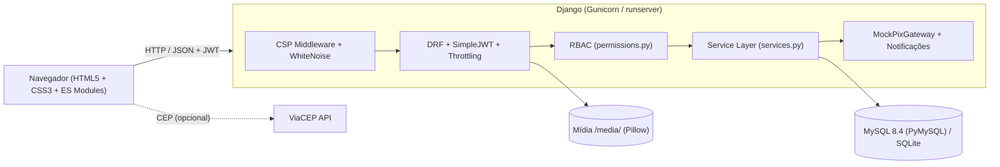
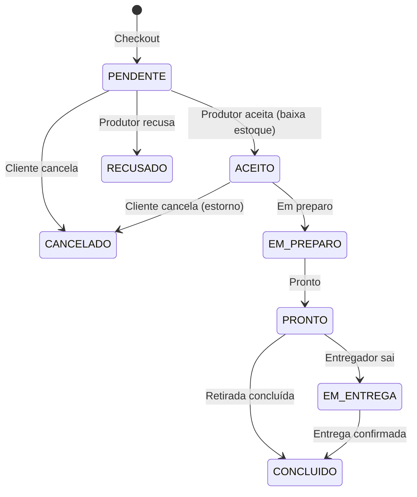

<p align="center">
  
</p>

<h1 align="center">Feira Virtual — Plataforma de Venda Direta</h1>

<p align="center">
  <strong>Disciplina:</strong> Engenharia de Software &nbsp;|&nbsp; <strong>Código:</strong> DCA3603<br />
  <strong>Integrantes:</strong> Débora Nicolly Araújo da Silva · Douglas Amon Passos dos Anjos · Caio de Miranda Silva · Paulo Guilherme Xavier da Silva
</p>

<p align="center">
  
  
  
  
  
  
  
  
</p>

---

## Sumário

1. [Princípios de Projeto e Engenharia de Software](#1-princípios-de-projeto-e-engenharia-de-software)
2. [Apresentação, Motivação e Objetivos](#2-apresentação-motivação-e-objetivos)
3. [Relação com os ODS (Agenda 2030)](#3-relação-com-os-ods-agenda-2030)
4. [Padrões de Projeto Aplicados](#4-padrões-de-projeto-aplicados)
5. [Critérios de Avaliação do Projeto](#5-critérios-de-avaliação-do-projeto)
   - [5.1. Projeto Conteinerizado](#51-projeto-conteinerizado) · [5.2. API](#52-api-com-os-principais-requisitos) · [5.3. Autenticação e Autorização](#53-autenticação-e-autorização) · [5.4. CI e Testes](#54-ci-e-testes) · [5.5. Front-End e Demonstração](#55-front-end-e-demonstração)
6. [Arquitetura, Tecnologias e Diretórios](#6-arquitetura-tecnologias-e-diretórios)
7. [Pré-requisitos e Execução (Local e Docker)](#7-pré-requisitos-e-execução-local-e-docker)
8. [Principais Endpoints e Testes](#8-principais-endpoints-e-testes)
9. [Considerações Finais](#9-considerações-finais)

---

## 1. Princípios de Projeto e Engenharia de Software

Aplicações web sustentáveis dependem de princípios que evitam acoplamento excessivo, facilitam testes e reduzem regressões:

| Princípio | Importância na Engenharia de Software | Evidência na Feira Virtual |
|---|---|---|
| **Modularidade** | Divide o sistema em unidades com fronteiras claras. | Backend em 5 apps (`usuarios`, `catalogo`, `pedidos`, `avaliacoes`, `painel`) + `config`; frontend em `main.js` e 9 ES Modules (`frontend/js/`). |
| **Separação de responsabilidades** | Isola camada HTTP, validação/serialização e domínio. | Views (`*/views.py`) tratam HTTP; serializers (`*/serializers.py`) validam contratos; `pedidos/services.py` concentra regras transacionais. |
| **Baixo acoplamento** | Permite substituir provedores sem alterar o núcleo. | Contratos em `pedidos/pix.py` (`GatewayPixBase`) e `pedidos/notificacoes.py` (`NotificadorBase`); frontend consome apenas `/api/` via `api.js`. |
| **Alta coesão** | Mantém entidades, regras e testes afins no mesmo módulo. | Cada app reúne seus próprios `models.py`, `serializers.py`, `views.py`, `urls.py` e `tests.py`. |
| **Reutilização de código** | Evita duplicação via abstrações e helpers comuns. | Classe base `_PorTipo` (`usuarios/permissions.py`), `mudar_status()` (`pedidos/services.py`), `apiFetch()` e `escapeHtml()`/`renderIcon()` (`frontend/js/`). |
| **Manutenibilidade** | Facilita correções e evolução segura do software. | 42 testes automatizados, logs estruturados, `LogAuditoria` (`painel/models.py`) e histórico Git com commits semânticos. |
| **Segurança** | Protege dados, sessões e operações por perfil. | RBAC + filtro anti-IDOR, CSP estrita (`config/middleware.py`), anti-*Path Traversal* (`config/urls.py`), throttles, Pillow em uploads e fluxos LGPD. |
| **Escalabilidade** | Prepara o sistema para crescimento de carga e dados. | Paginação (`PAGE_SIZE = 20`), índices de banco, `select_related`/`prefetch_related`, Gunicorn, WhiteNoise e MySQL 8.4 *(uploads locais em `/media/` exigiriam S3/R2 em múltiplas réplicas)*. |

---

## 2. Apresentação, Motivação e Objetivos

A **Feira Virtual** é uma plataforma web de **venda direta da agricultura familiar**, integrando **produtores rurais**, **consumidores finais**, **entregadores parceiros** e **administradores** em um único ambiente digital — cobrindo catálogo, carrinho unificado (com divisão automática de pedidos por produtor), estoque transacional, entregas, avaliações pós-compra e reclamações.

### Motivação e Objetivos

Pequenos produtores enfrentam baixa visibilidade comercial, dependência de intermediários, distanciamento dos consumidores urbanos e desorganização no controle de pedidos, estoques e entregas. Para contribuir frente a esses entraves, o sistema busca:

1. **Viabilizar a venda direta** e dar visibilidade a propriedades rurais aprovadas e seus produtos (`kg`, `g`, `L`, `ml`, `unidade`, `caixa`, `saco`, `maço`; cultivo orgânico certificado, agroecológico ou convencional).
2. **Promover transparência** de origem, preços, estoque disponível, formas de pagamento aceitas e avaliações vinculadas a compras reais.
3. **Organizar pedidos, estoque e logística**, com baixa/estorno transacional de estoque e painéis dedicados por perfil.

> **Nota metodológica:** por se tratar de projeto acadêmico, benefícios como redução de intermediários, ganho de renda ou redução de perdas são **objetivos e contribuições potenciais da proposta**, não resultados empíricos comprovados.

---

## 3. Relação com os ODS (Agenda 2030)

Referência oficial: [Nações Unidas Brasil (Agenda 2030)](https://brasil.un.org/pt-br/sdgs).

<table>
  <thead>
    <tr>
      <th width="110">Ícone</th>
      <th>Objetivo e Meta (ONU Brasil)</th>
      <th>Vínculo com Funcionalidades Reais</th>
    </tr>
  </thead>
  <tbody>
    <tr>
      <td align="center">
        <a href="https://brasil.un.org/pt-br/sdgs/2"></a>
      </td>
      <td><strong><a href="https://brasil.un.org/pt-br/sdgs/2">ODS 2 — Fome Zero e Agricultura Sustentável</a></strong><br /><em>Meta 2.3:</em> acesso a mercados e agregação de valor para pequenos produtores e agricultores familiares.</td>
      <td>Vitrine pública de produtores aprovados (<code>/api/produtores/</code>), perfil da propriedade (<code>PerfilProdutor</code>) e catálogo direto (<code>/api/produtos/</code>).</td>
    </tr>
    <tr>
      <td align="center">
        <a href="https://brasil.un.org/pt-br/sdgs/8"></a>
      </td>
      <td><strong><a href="https://brasil.un.org/pt-br/sdgs/8">ODS 8 — Trabalho Decente e Crescimento Econômico</a></strong><br /><em>Meta 8.3:</em> apoio a atividades produtivas, empreendedorismo local e micro/pequenos empreendimentos.</td>
      <td>Workspaces operacionais de Produtor Rural (vendas e resumo em <code>/api/produtor/pedidos/</code>) e Entregador (<code>/api/entregas/</code> e extrato).</td>
    </tr>
    <tr>
      <td align="center">
        <a href="https://brasil.un.org/pt-br/sdgs/12"></a>
      </td>
      <td><strong><a href="https://brasil.un.org/pt-br/sdgs/12">ODS 12 — Consumo e Produção Responsáveis</a></strong><br /><em>Meta 12.3:</em> redução do desperdício de alimentos no varejo/consumo e de perdas na cadeia.</td>
      <td>Classificação clara do tipo de produção e controle estrito de estoque/pedidos sob demanda (<code>pedidos/services.py</code>). <em>Limitação: o sistema não mede diretamente redução de desperdício.</em></td>
    </tr>
  </tbody>
</table>

> *Uso estritamente acadêmico dos ícones conforme diretrizes da [ONU Brasil](https://brasil.un.org/pt-br/node/110468), sem vínculo institucional com a ONU.*

---

## 4. Padrões de Projeto Aplicados

Distingue-se no código: **Padrões GoF** (`Strategy`, `Adapter`, `Template Method`, `Facade`), **Padrão Arquitetural/Corporativo** (`Service Layer`, sobre arquitetura de *Monólito Modular*) e **boas práticas** (*snapshot* em `ItemPedido`, *soft delete* com `LogAuditoria`, `select_for_update()` e middleware CSP).

| Padrão | Classificação | Objetivo (Problema) | Aplicação e Evidência no Código | Benefícios |
|---|---|---|---|---|
| **Service Layer** | Arquitetural / Corporativo | Evitar regras de negócio e transações espalhadas nas views HTTP. | `finalizar_carrinho()`, `mudar_status()`, `validar_pagamento()`, `_baixar_estoque()`, `_devolver_estoque()`, `TRANSICOES` em [`pedidos/services.py`](pedidos/services.py). | Atomicidade (`@transaction.atomic` + `select_for_update()`), views enxutas e reuso único da máquina de estados. |
| **Strategy** (+ Factory) | GoF Comportamental | Desacoplar pedidos das implementações concretas de Pix e notificações. | [`pedidos/pix.py`](pedidos/pix.py) (`GatewayPixBase`, `MockPixGateway`, `obter_gateway_pix()`) e [`pedidos/notificacoes.py`](pedidos/notificacoes.py) (`NotificadorBase`, `NotificadorEmail`, `NotificadorWhatsApp`, `CentralNotificacoes`). | Facilita plugar gateways reais sem alterar o domínio e isola falhas entre canais. |
| **Adapter** | GoF Estrutural | Compatibilizar `PyMySQL` (Python puro) com a API `MySQLdb` exigida pelo Django. | [`config/__init__.py`](config/__init__.py) (`pymysql.install_as_MySQLdb()`) e [`entrypoint.sh`](entrypoint.sh). | Build Docker sem `gcc`/`mysqlclient` e troca transparente SQLite ↔ MySQL. |
| **Template Method** | GoF Comportamental | Evitar repetição da checagem de perfil nas permissões DRF. | `_PorTipo.has_permission()` herdado por `EhCliente`, `EhProdutor`, `EhEntregador` e `EhAdmin` em [`usuarios/permissions.py`](usuarios/permissions.py). | Controle RBAC declarativo e uniforme em todos os endpoints. |
| **Facade** | GoF Estrutural | Encapsular JWT, renovação `401` concorrente e parse de erros no frontend. | `apiFetch()`, `refreshAccessToken()`, `processQueue()`, `tokens` e `parseError()` em [`frontend/js/api.js`](frontend/js/api.js). | Desacopla os módulos de tela do protocolo HTTP e evita *race condition* no refresh. |

> **Aviso sobre simulações:** `MockPixGateway` (`"simulado": True`) e `NotificadorWhatsApp` (`[WHATSAPP MOCK]`) são implementações **simuladas** para testes/demonstração; `NotificadorEmail` usa `console.EmailBackend` em dev (suportando SMTP em produção via `EMAIL_*`).

---

## 5. Critérios de Avaliação do Projeto

| Critério | Evidência Direta |
|---|---|
| **Projeto Conteinerizado** | [`Dockerfile`](Dockerfile), [`docker-compose.yml`](docker-compose.yml), [`entrypoint.sh`](entrypoint.sh) ([Seção 5.1](#51-projeto-conteinerizado) e [Seção 7](#7-pré-requisitos-e-execução-local-e-docker)) |
| **API com os Principais Requisitos** | 5 apps DRF + [`pedidos/services.py`](pedidos/services.py) + OpenAPI/Swagger (`/api/docs/`) ([Seção 5.2](#52-api-com-os-principais-requisitos) e [Seção 8](#8-principais-endpoints-e-testes)) |
| **Autenticação e Autorização** | `SimpleJWT`, `token_blacklist`, CSRF, throttles e [`usuarios/permissions.py`](usuarios/permissions.py) ([Seção 5.3](#53-autenticação-e-autorização)) |
| **CI e Testes** | 42 testes aprovados + `check`, `makemigrations --check` e `spectacular --validate` *(CI pendente na `dev`)* ([Seção 5.4](#54-ci-e-testes)) |
| **Front-End e Demonstração** | `frontend/` (HTML5, CSS3, 10 módulos ES, sprite SVG) e roteiro com `seed_demo` ([Seção 5.5](#55-front-end-e-demonstração)) |

### 5.1. Projeto Conteinerizado

Padroniza ambiente, isola aplicação e SGBD, e garante portabilidade com usuário sem privilégios:
- **[`Dockerfile`](Dockerfile):** base `python:3.12-slim`, usuário não-root `appuser` (`HOME=/home/appuser`), dependências via `PyMySQL` (sem `gcc`), WhiteNoise (`collectstatic` no build), `HEALTHCHECK` Python stdlib em `/api/health/` e **Gunicorn** (`3 workers`, `--timeout 60`).
- **[`docker-compose.yml`](docker-compose.yml):** serviço `db` (**MySQL 8.4**, volume `mysql_data`, porta `127.0.0.1:3306:3306`, `healthcheck` com `MYSQL_PWD`) e serviço `web` (dependente de `db` saudável, `DB_HOST: db`, volume `media_data`, porta `8000:8000`).
- **[`entrypoint.sh`](entrypoint.sh):** aguarda o MySQL responder e aplica `python manage.py migrate --noinput` antes de iniciar o Gunicorn. *(Comandos na [Seção 7](#7-pré-requisitos-e-execução-local-e-docker)).*

### 5.2. API com os Principais Requisitos

API REST em **DRF** (JSON / `multipart` para imagens validadas com Pillow, `PAGE_SIZE = 20`, busca, filtros e ordenação), cobrindo **Usuários** (cadastro, perfis, endereços, LGPD), **Catálogo** (categorias com `ProtectedError`, produtos, produtores aprovados, estoque), **Pedidos** (carrinho, checkout separado por produtor, máquina de estados, cancelamento e Pix simulado), **Entregas** (disponíveis com endereço resumido, aceite atômico, `EM_ENTREGA → CONCLUIDO`, histórico), **Avaliações** (produto, produtor, recíproca de cliente e reclamações) e **Administração** (moderação, soft delete, indicadores e `LogAuditoria`).

Documentação OpenAPI em `http://127.0.0.1:8000/api/docs/` e `/api/schema/` *(restrita a admins por padrão; liberada com `ENABLE_SWAGGER=1`)*. Serviço Pix em `/api/pedidos/{id}/pix/` é simulado (`MockPixGateway`, `"simulado": true`).

### 5.3. Autenticação e Autorização

- **Autenticação (`SimpleJWT` em `config/settings.py` e `usuarios/views.py`):** `ACCESS_TOKEN_LIFETIME = 1h`, `REFRESH_TOKEN_LIFETIME = 7d`, `token_blacklist`, throttles (`login`: `10/min`; `registro`/`recuperar_senha`: `5/min`), recuperação de senha com resposta neutra e validação no `LogoutView` impedindo revogar token de outro usuário (`403`).
- **CSRF, `HttpOnly` e Rotação:** `CsrfViewMiddleware`, `CSRF_TRUSTED_ORIGINS` e cookies `HttpOnly`/`Secure` (quando `SECURE_SSL_REDIRECT=1`) protegem `SessionAuthentication` (Django Admin). No frontend (`frontend/js/api.js`), o JWT usa `localStorage` protegido por CSP estrita (`script-src 'self'`) e sanitização `escapeHtml()`/`safeUrl()`, com `ROTATE_REFRESH_TOKENS = False` — migração para cookies `HttpOnly` com rotação automática está mapeada como evolução futura.
- **Autorização (RBAC + Anti-IDOR):** política padrão `IsAuthenticated`, hierarquia `_PorTipo` em [`usuarios/permissions.py`](usuarios/permissions.py) (`EhCliente`, `EhProdutor`, `EhEntregador`, `EhAdmin`, mais `AdminEscreveTodosLeem`) e filtragem de `get_queryset()` por titular autenticado:

| Perfil | Responsabilidades e Restrições de Acesso |
|---|---|
| **Cliente** (`EhCliente`) | Compra no catálogo, gerencia carrinho/endereços, acompanha/cancela próprios pedidos, avalia após conclusão e registra reclamações. |
| **Produtor Rural** (`EhProdutor`) | Gerencia propriedade, produtos, pedidos recebidos, vendas e avaliação recíproca de clientes; não reverte `oculto_moderacao`. |
| **Entregador** (`EhEntregador`) | Vê endereço resumido antes do aceite; só avança entregas próprias na ordem `PRONTO → EM_ENTREGA → CONCLUIDO`. |
| **Administrador** (`EhAdmin`) | Gerencia usuários, aprova/suspende produtores, modera produtos/avaliações/reclamações/categorias e audita via `LogAuditoria`. |

### 5.4. CI e Testes

**42 testes automatizados aprovados** (87% de cobertura medida via `coverage`):

| Módulo | Testes | Escopo Principal |
|---|---|---|
| [`usuarios/tests.py`](usuarios/tests.py) | **10** | Cadastros, foto da propriedade, endereços, LGPD (com senha e suspensão de produtor), logout seguro, anti-*Path Traversal*, `/api/config/` e link de senha |
| [`catalogo/tests.py`](catalogo/tests.py) | **9** | Categorias (`ProtectedError`), visibilidade pública sem vazar `chave_pix`, filtros, isolamento entre produtores, CSP/healthcheck e upload inválido |
| [`pedidos/tests.py`](pedidos/tests.py) | **13** | Fluxo completo, estorno de estoque, split por produtor, Pix + webhook HMAC, frete no servidor, unidades, endereço resumido, aceite duplicado e categoria inativa |
| [`avaliacoes/tests.py`](avaliacoes/tests.py) | **4** | Avaliação restrita a pedido concluído, reclamações, avaliação recíproca do produtor ao cliente e histórico/autoria |
| [`painel/tests.py`](painel/tests.py) | **6** | Permissões admin, bloqueio/reativação e reclamações com `LogAuditoria`, moderação de produtores/produtos e soft delete |

**Verificações executadas localmente sobre a base atual:** `python manage.py check` (0 issues), `makemigrations --check --dry-run` (No changes), `spectacular --validate` (válido) e `manage.py test` (**42/42 OK**).  
**Situação do CI:** não há `.github/workflows/ci.yml` presente atualmente na branch `dev` (existiu apenas em commits anteriores da `main`); integração contínua no GitHub Actions encontra-se **pendente na `dev`**.

### 5.5. Front-End e Demonstração

- **Stack e Acessibilidade:** HTML5, CSS3 (tokens, paleta `#246F11` / `#1B4312` / `#67AE25` / `#F7990C` / `#FAFAF8` / `#141712`, Light/Dark Mode, `prefers-reduced-motion`, áreas clicáveis ≥ `44px`, *focus trap*, `Escape`, `aria-live`, toggle de senha), ES Modules (`frontend/main.js` + `frontend/js/*.js`) e sprite SVG local (`frontend/assets/icons.svg`), sem dependências de CDN (`script-src 'self'`).
- **Roteiro prático (`seed_demo` — dados realistas do RN):** em `DEBUG=1`, execute `python manage.py seed_demo` (popula 6 produtores aprovados + 1 pendente do RN, 30 produtos públicos, 5 clientes, 3 entregadores, 20 pedidos e 26 avaliações; imprime usuários e senhas temporárias das contas `cliente_demo`, `produtor_demo`, `entregador_demo` e `admin` apenas no terminal):
  1. **Visitante:** abrir `/`, alternar tema claro/escuro, filtrar catálogo e consultar produtores do RN.
  2. **Cliente (`cliente_demo`):** cadastrar endereço (ViaCEP), adicionar itens, finalizar checkout (Pix simulado) e ver timeline em *Meus Pedidos*.
  3. **Produtor (`produtor_demo`):** abrir workspace do produtor, editar produto, aceitar pedido pendente (baixa estoque) e avançar até `Pronto`.
  4. **Entregador (`entregador_demo`):** painel sem catálogo, conferir endereço resumido, aceitar entrega, marcar *Saiu para entrega* e *Confirmar entrega*.
  5. **Avaliações e Admin (`admin`):** avaliar pedido concluído como cliente, depois acessar o workspace Admin para visualizar KPIs, fila de pendências, aprovação de produtor e moderação.

<p align="center">
  
</p>

*(Pendência visual: o repositório versiona logos WebP/PNG, ícones PWA e `og-image.png`, ainda sem capturas de tela das telas em execução em `docs/screenshots/`.)*

---

## 6. Arquitetura, Tecnologias e Diretórios





**Tecnologias:** Python 3.12 · Django 6.1 · DRF 3.18 · SimpleJWT (`token_blacklist`) · `django-filter` · `django-cors-headers` · `drf-spectacular` · PyMySQL / MySQL 8.4 / SQLite · Pillow · WhiteNoise · Gunicorn · Docker Compose · HTML5/CSS3/ES Modules · `coverage` / `pytest-django` / `ruff`.

```text
feira_virtual/
├── config/       # settings.py, urls.py, __init__.py (Adapter PyMySQL), middleware.py (CSP), validators.py
├── usuarios/     # Usuario (4 perfis), PerfilProdutor, PerfilEntregador, Endereco, permissions.py, LGPD, seed_demo.py
├── catalogo/     # Categoria, Produto, vitrine pública e estatísticas
├── pedidos/      # Carrinho, Pedido, ItemPedido (snapshot), services.py, pix.py (Mock), notificacoes.py, entregas
├── avaliacoes/   # Avaliacao (produto/produtor), AvaliacaoCliente (recíproca) e Reclamacao
├── painel/       # Moderação admin, indicadores e LogAuditoria
├── frontend/     # index.html, style.css, main.js, js/ (9 ES Modules) e assets/ (logos, icons.svg, og-image.png)
└── Dockerfile · docker-compose.yml · entrypoint.sh · requirements.txt · requirements-dev.txt · .env.example
```

---

## 7. Pré-requisitos e Execução (Local e Docker)

- **Local sem Docker:** Python 3.12+, `pip` e `venv` (SQLite incluso no Python; MySQL 8.x opcional).
- **Com Docker:** Docker Engine e Docker Compose (`docker compose` v2).

### Configuração Local sem Docker

```bash
python3 -m venv .venv && source .venv/bin/activate
pip install -r requirements.txt -r requirements-dev.txt
cp .env.example .env
export DJANGO_DEBUG=1
python manage.py migrate
python manage.py seed_demo      # opcional: popula dados do RN (use --reset para recriar)
python manage.py runserver
```

- Interface: `http://127.0.0.1:8000/` · Swagger: `http://127.0.0.1:8000/api/docs/` · Admin: `http://127.0.0.1:8000/admin/` · Health: `http://127.0.0.1:8000/api/health/`
- Acesso externo (celular): `ngrok http 8000` ou `cloudflared tunnel --url http://localhost:8000`.
- MySQL local (sem Docker): crie o banco `feira_virtual` (`utf8mb4_unicode_ci`) e ajuste `DB_ENGINE=mysql`, `DB_NAME`, `DB_USER`, `DB_PASSWORD`, `DB_HOST`, `DB_PORT` no `.env`.

### Inicialização com Docker (`Django` + `MySQL 8.4`)

```bash
cp .env.example .env            # defina DJANGO_SECRET_KEY e senhas
docker compose up --build -d    # sobe db + web e aplica migrações via entrypoint.sh
docker compose ps               # verifica saúde dos containers
docker compose logs -f web      # acompanha logs da aplicação
# Para subir só o banco: docker compose up db -d | Encerrar: docker compose down
```

### Variáveis de Ambiente Principais ([`.env.example`](.env.example))

| Variável | Padrão | Finalidade |
|---|---|---|
| `DJANGO_DEBUG` / `DJANGO_SECRET_KEY` | `0` / *(obrigatória em prod)* | Modo debug e chave secreta (50+ chars aleatórios com `DEBUG=0`). |
| `DJANGO_ALLOWED_HOSTS` / `SECURE_SSL_REDIRECT` | vazio / `1` (`0` no compose local) | Hosts permitidos e redirecionamento HTTPS/HSTS/cookies seguros atrás de TLS. |
| `DB_ENGINE` (+ `DB_*`) | `sqlite` | Seleciona `sqlite` ou `mysql`. |
| `ENABLE_SWAGGER` / `SHOW_DEMO_SHORTCUTS` | `0` / `0` | Libera `/api/docs/` publicamente / exibe atalhos demo no login (apenas local). |
| `CORS_*` / `CSRF_TRUSTED_ORIGINS` | `0` (prod) / `localhost` + túneis | Origens permitidas para CORS e CSRF. |
| `EMAIL_*` / `THROTTLE_*` | console (dev) / `.env.example` | SMTP de produção e limites de requisição (`login`, `registro`, `recuperar_senha`). |
| `PIX_WEBHOOK_SECRET` / `TAXA_ENTREGA_PADRAO` | vazio / `0.00` | Segredo HMAC-SHA256 do webhook Pix e frete definido exclusivamente no servidor. |

**Checklist de produção:** `DJANGO_DEBUG=0`, `DJANGO_SECRET_KEY` forte, `DB_ENGINE=mysql`, `PIX_WEBHOOK_SECRET`, SMTP real, `ALLOWED_HOSTS`/`CORS`/`CSRF` restritos, `SECURE_SSL_REDIRECT=1` atrás de proxy TLS, `collectstatic --no-input` e `check --deploy`.

---

## 8. Principais Endpoints e Testes

| Módulo | Principais Rotas REST |
|---|---|
| **Usuários & LGPD** (`usuarios/urls.py`) | `POST /api/auth/registro/{cliente,produtor,entregador}/` · `POST /api/auth/{login,refresh,logout,recuperar-senha,redefinir-senha}/` · `GET/PATCH /api/perfil/` (`/produtor/`, `/entregador/`) · `CRUD /api/enderecos/` · `GET /api/perfil/exportar-dados/` · `DELETE /api/perfil/excluir-conta/` |
| **Catálogo** (`catalogo/urls.py`) | `CRUD /api/categorias/` · `GET /api/produtos/` (`?search=`, `?categoria=`, `?tipo_producao=`, `?produtor=`, `?ordering=`, `?page=`) · `GET /api/produtores/` · `GET /api/estatisticas/` · `CRUD /api/produtor/produtos/` |
| **Pedidos & Pix** (`pedidos/urls.py`) | `GET/DELETE /api/carrinho/` · `POST/PATCH/DELETE /api/carrinho/itens/` · `POST/GET /api/pedidos/` · `POST /api/pedidos/{id}/cancelar/` · `GET /api/pedidos/{id}/pix/` *(simulado)* · `POST /api/pedidos/pix/webhook/` · `GET/POST /api/produtor/pedidos/` (`/{id}/aceitar/`, `/recusar/`, `/status/`, `/vendas/`, `/resumo/`) |
| **Entregas** (`pedidos/urls.py`) | `GET /api/entregas/?escopo=disponiveis\|minhas\|historico` · `GET /api/entregas/resumo/` · `POST /api/entregas/{id}/{aceitar,saiu-para-entrega,confirmar}/` |
| **Avaliações** (`avaliacoes/urls.py`) | `CRUD /api/avaliacoes/` · `GET /api/avaliacoes/minhas/` · `GET /api/produtor/avaliacoes/` · `GET/POST /api/produtor/avaliacoes-clientes/` · `GET/POST /api/reclamacoes/` |
| **Admin & Sistema** (`painel/urls.py`, `config/urls.py`) | `GET /api/admin/indicadores/` · `/api/admin/{usuarios,produtores,produtos,pedidos,reclamacoes,avaliacoes,avaliacoes-clientes}/` · `GET /api/config/` · `GET /api/health/` · `GET /api/schema/` · `GET /api/docs/` |

```bash
python manage.py check
python manage.py makemigrations --check --dry-run
python manage.py test -v 2
python manage.py spectacular --validate --file /tmp/schema.yml
DJANGO_DEBUG=0 DJANGO_SECRET_KEY='<chave-50+-caracteres>' DJANGO_ALLOWED_HOSTS=localhost SECURE_SSL_REDIRECT=1 python manage.py check --deploy
```

---

## 9. Considerações Finais

A **Feira Virtual** consolida modelagem relacional, arquitetura modular, padrões de projeto verificáveis no código, RBAC + proteção LGPD, compatibilidade SQLite/MySQL 8.4, containerização e 42 testes automatizados aplicados à disciplina **Engenharia de Software (DCA3603)** e alinhados aos ODS 2, 8 e 12.

**Pendências registradas:** (1) adicionar `.github/workflows/ci.yml` na branch `dev`; (2) versionar capturas de tela reais em `docs/screenshots/`; (3) migrar JWT no frontend para cookies `HttpOnly` com `ROTATE_REFRESH_TOKENS = True`; (4) substituir `MockPixGateway` e `NotificadorWhatsApp` por integrações homologadas em produção; e (5) incluir arquivo `LICENSE` e testes E2E.
