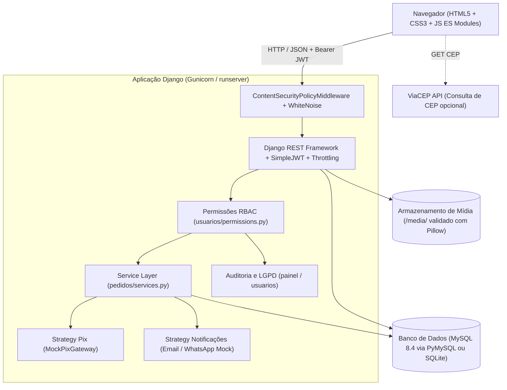
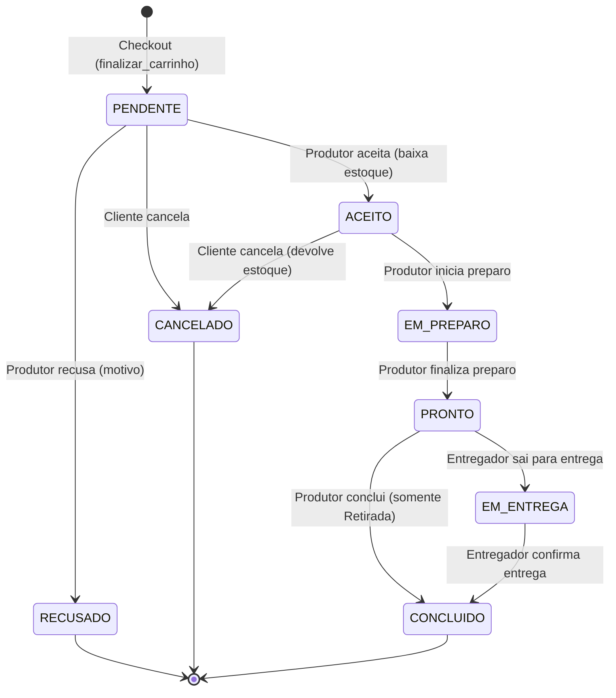

<p align="center">
  
</p>

<h1 align="center">Feira Virtual — Plataforma de Venda Direta</h1>

<p align="center">
  <strong>Disciplina:</strong> Engenharia de Software &nbsp;|&nbsp; <strong>Código da disciplina:</strong> DCA3603
</p>

<p align="center">
  <strong>Integrantes:</strong><br />
  Débora Nicolly Araújo da Silva · Douglas Amon Passos dos Anjos · Caio de Miranda Silva · Paulo Guilherme Xavier da Silva 
</p>

<p align="center">
  
  
  
  
  
  
  
  
</p>

---

## Sumário

1. [Princípios de Projeto e Engenharia de Software](#1-princípios-de-projeto-e-engenharia-de-software)
2. [Apresentação do Projeto](#2-apresentação-do-projeto)
3. [Motivação e Objetivos](#3-motivação-e-objetivos)
4. [Relação com os Objetivos de Desenvolvimento Sustentável (ODS)](#4-relação-com-os-objetivos-de-desenvolvimento-sustentável-ods)
5. [Padrões de Projeto Aplicados](#5-padrões-de-projeto-aplicados)
6. [Acompanhamento do Desenvolvimento](#6-acompanhamento-do-desenvolvimento)
7. [Apresentação do Projeto e Requisitos de Avaliação](#7-apresentação-do-projeto-e-requisitos-de-avaliação)
   - [7.1. Projeto Conteinerizado](#71-projeto-conteinerizado)
   - [7.2. API com os Principais Requisitos](#72-api-com-os-principais-requisitos)
   - [7.3. Autenticação e Autorização](#73-autenticação-e-autorização)
   - [7.4. CI e Testes](#74-ci-e-testes)
   - [7.5. Front-End e Demonstração](#75-front-end-e-demonstração)
8. [Arquitetura e Tecnologias](#8-arquitetura-e-tecnologias)
9. [Organização dos Diretórios](#9-organização-dos-diretórios)
10. [Pré-requisitos](#10-pré-requisitos)
11. [Configuração Local sem Docker](#11-configuração-local-sem-docker)
12. [Inicialização com Docker](#12-inicialização-com-docker)
13. [Principais Endpoints da API](#13-principais-endpoints-da-api)
14. [Execução dos Testes](#14-execução-dos-testes)
15. [Considerações Finais](#15-considerações-finais)

---

## 1. Princípios de Projeto e Engenharia de Software

O desenvolvimento de aplicações web confiáveis e sustentáveis exige decisões estruturais fundamentadas em princípios consolidados da Engenharia de Software. Sem essa disciplina, sistemas crescem de forma acoplada, tornam-se difíceis de testar e acumulam vulnerabilidades e regressões a cada nova funcionalidade.

Os principais princípios que orientam o projeto arquitetural de sistemas web e sua aplicação verificável na **Feira Virtual** são apresentados a seguir:

| Princípio | Definição e Importância | Aplicação e Evidência na Feira Virtual |
|---|---|---|
| **Modularidade** | Divisão do sistema em unidades independentes e compreensíveis, cada qual tratando de um subdomínio claro. | O backend é segmentado em cinco aplicativos Django (`usuarios`, `catalogo`, `pedidos`, `avaliacoes`, `painel`), mais `config`; o frontend divide-se em `frontend/main.js` e 9 ES Modules em `frontend/js/`. |
| **Separação de responsabilidades** | Cada camada ou módulo concentra apenas tarefas ligadas à sua finalidade, evitando misturar apresentação, transporte HTTP e regras de negócio. | Views (`*/views.py`) tratam o protocolo HTTP, serializers (`*/serializers.py`) validam e serializam contratos, e `pedidos/services.py` encapsula a lógica transacional de pedidos e estoque. |
| **Baixo acoplamento** | Redução de dependências rígidas entre componentes, facilitando substituições e evolução isolada. | Contratos abstratos em `pedidos/pix.py` (`GatewayPixBase`) e `pedidos/notificacoes.py` (`NotificadorBase`) desacoplam o domínio de provedores externos; o frontend comunica-se exclusivamente via `/api/` (`frontend/js/api.js`). |
| **Alta coesão** | Agrupamento de modelos, regras, endpoints e testes fortemente relacionados dentro do mesmo módulo. | Cada app reúne seus próprios `models.py`, `serializers.py`, `views.py`, `urls.py` e `tests.py` (por exemplo, toda a gestão de avaliações e reclamações reside em `avaliacoes/`). |
| **Reutilização de código** | Eliminação de duplicação por meio de abstrações compartilhadas e utilitários centralizados. | Hierarquia `_PorTipo` em `usuarios/permissions.py`; função `mudar_status()` reutilizada por Cliente, Produtor e Entregador em `pedidos/services.py`; utilitários `apiFetch()`, `escapeHtml()` e `renderIcon()` em `frontend/js/`. |
| **Manutenibilidade** | Facilidade de diagnosticar defeitos, aplicar correções e evoluir o software com baixo risco de regressão. | Suíte de 42 testes automatizados (`*/tests.py`), logs estruturados (`config/settings.py`), trilha `LogAuditoria` (`painel/models.py`) e histórico versionado com commits semânticos no Git. |
| **Segurança** | Proteção de dados, autenticação robusta, controle de acesso por perfil e defesa contra ataques comuns em aplicações web. | RBAC em `usuarios/permissions.py`, isolamento de querysets contra IDOR, CSP estrita (`config/middleware.py`), proteção contra *Path Traversal* (`config/urls.py`), throttles por escopo, validação binária de uploads (`config/validators.py`) e fluxos LGPD. |
| **Escalabilidade** | Organização da aplicação de modo a permitir crescimento de carga, volume de dados e evolução de infraestrutura. | Paginação global (`PAGE_SIZE = 20`), índices de banco de dados nos modelos, consultas otimizadas com `select_related`/`prefetch_related`, Gunicorn multi-worker, WhiteNoise e suporte a MySQL 8.4. *(Nota: em múltiplas réplicas horizontais, o armazenamento local em `/media/` exigiria migração para storage de objetos como S3/R2.)* |

---

## 2. Apresentação do Projeto

A **Feira Virtual** é uma plataforma web full-stack projetada para apoiar a **comercialização direta entre produtores rurais da agricultura familiar e consumidores finais**, incorporando também **entregadores parceiros** e **administradores** em um único ambiente integrado.

Mais do que uma vitrine de produtos, a aplicação estrutura todo o ciclo operacional da compra agrícola:

- Divulgação de propriedades rurais e produtos frescos com preço, unidade de medida (`kg`, `g`, `L`, `ml`, `unidade`, `caixa`, `saco`, `maço`), estoque e tipo de cultivo (`Orgânico certificado`, `Agroecológico`, `Convencional`).
- Carrinho unificado com separação automática de pedidos por produtor no momento do checkout.
- Controle transacional de estoque (baixa no aceite do produtor e devolução em caso de recusa ou cancelamento).
- Coordenação de entregas por entregadores cadastrados, com rastreamento de estados e privacidade do endereço do cliente até o aceite da entrega.
- Avaliações vinculadas a compras concluídas (de produtos, de produtores e avaliação recíproca do produtor ao cliente) e canal de reclamações moderado pela administração.

Cada perfil acessa uma experiência dedicada às suas atribuições: **Cliente**, **Produtor Rural**, **Entregador** e **Administrador**.

---

## 3. Motivação e Objetivos

### 3.1. Motivação

Produtores da agricultura familiar frequentemente enfrentam entraves operacionais e comerciais que limitam seu acesso direto aos consumidores. O desenvolvimento da Feira Virtual foi motivado pelos seguintes problemas recorrentes:

- **Dificuldade de divulgação e comercialização:** pequenos produtores nem sempre dispõem de canais digitais próprios para apresentar seus produtos sazonais e preços atualizados.
- **Dependência de intermediários:** a ausência de contato direto com o comprador final costuma reduzir a autonomia comercial e a margem de retorno do agricultor.
- **Distanciamento entre produtores locais e consumidores:** moradores urbanos encontram dificuldade para descobrir produtores próximos, verificar disponibilidade real e conhecer a origem e o modo de cultivo dos alimentos.
- **Gestão fragmentada de pedidos, estoques e entregas:** controles informais elevam erros de disponibilidade, atrasos na preparação e falta de rastreabilidade nas entregas.
- **Ausência de um ambiente digital integrado:** ferramentas genéricas raramente contemplam em conjunto a vitrine rural, o controle transacional de estoque, a logística de entrega local e a moderação administrativa.

A Feira Virtual procura contribuir para enfrentar esses desafios oferecendo uma arquitetura web unificada, responsiva e orientada a regras de negócio consistentes.

> **Nota metodológica:** por se tratar de um sistema desenvolvido em contexto acadêmico, ainda sem implantação comercial em escala, os benefícios sociais e econômicos descritos representam **objetivos e contribuições potenciais da solução**, não resultados empíricos comprovados.

### 3.2. Objetivos do Projeto

1. **Viabilizar a venda direta** de produtos da agricultura familiar entre produtores e consumidores.
2. **Facilitar a divulgação de propriedades e produtos rurais**, com busca textual, filtros por categoria e classificação do tipo de produção.
3. **Promover transparência nas informações e nos preços**, exibindo dados do produtor, estoque disponível, formas de pagamento aceitas e avaliações reais pós-compra.
4. **Organizar pedidos e controle de estoque**, protegendo a consistência dos saldos em cenários concorrentes.
5. **Facilitar o gerenciamento das entregas**, integrando entregadores ao fluxo de pedidos prontos com controle rígido de transições de estado.
6. **Disponibilizar ambientes específicos por perfil**, separando claramente as interfaces e permissões de clientes, produtores rurais, entregadores e administradores.

---

## 4. Relação com os Objetivos de Desenvolvimento Sustentável (ODS)

A proposta da Feira Virtual dialoga com a **Agenda 2030 da Organização das Nações Unidas (ONU)**, tomando como referência as páginas oficiais das [Nações Unidas Brasil](https://brasil.un.org/pt-br/sdgs). Os três ODS mais alinhados às funcionalidades implementadas são:

<table>
  <thead>
    <tr>
      <th width="130">Ícone</th>
      <th>Objetivo e Meta de Referência (ONU Brasil)</th>
      <th>Contribuição Potencial e Vínculo com o Sistema</th>
    </tr>
  </thead>
  <tbody>
    <tr>
      <td align="center">
        <a href="https://brasil.un.org/pt-br/sdgs/2">
          
        </a>
      </td>
      <td>
        <strong><a href="https://brasil.un.org/pt-br/sdgs/2">ODS 2 — Fome Zero e Agricultura Sustentável</a></strong><br />
        <em>Meta 2.3:</em> até 2030, dobrar a produtividade agrícola e a renda dos pequenos produtores de alimentos — particularmente agricultores familiares —, inclusive por meio de acesso a mercados e oportunidades de agregação de valor.
      </td>
      <td>
        A vitrine de produtores aprovados (<code>GET /api/produtores/</code>), o perfil da propriedade rural (<code>PerfilProdutor</code>) e o catálogo de venda direta (<code>GET /api/produtos/</code>) estruturam um canal digital voltado à valorização da agricultura familiar e à ampliação do acesso ao mercado.
      </td>
    </tr>
    <tr>
      <td align="center">
        <a href="https://brasil.un.org/pt-br/sdgs/8">
          
        </a>
      </td>
      <td>
        <strong><a href="https://brasil.un.org/pt-br/sdgs/8">ODS 8 — Trabalho Decente e Crescimento Econômico</a></strong><br />
        <em>Meta 8.3:</em> promover políticas e iniciativas orientadas para o desenvolvimento que apoiem atividades produtivas, geração de trabalho decente, empreendedorismo, criatividade, inovação e o fortalecimento de micro e pequenos empreendimentos.
      </td>
      <td>
        Os workspaces dedicados de Produtor Rural (gestão de produtos, pedidos e relatórios de vendas em <code>/api/produtor/pedidos/resumo/</code> e <code>/vendas/</code>) e de Entregador (<code>/api/entregas/</code> e <code>/resumo/</code>) oferecem suporte operacional que pode fortalecer o empreendedorismo local e a geração de oportunidades para produtores e entregadores parceiros.
      </td>
    </tr>
    <tr>
      <td align="center">
        <a href="https://brasil.un.org/pt-br/sdgs/12">
          
        </a>
      </td>
      <td>
        <strong><a href="https://brasil.un.org/pt-br/sdgs/12">ODS 12 — Consumo e Produção Responsáveis</a></strong><br />
        <em>Meta 12.3:</em> até 2030, reduzir o desperdício de alimentos nos níveis de varejo e do consumidor e reduzir as perdas ao longo das cadeias de produção e abastecimento.
      </td>
      <td>
        A transparência sobre o tipo de produção (<code>ORGANICO_CERTIFICADO</code>, <code>AGROECOLOGICO</code>, <code>CONVENCIONAL</code>), a aproximação entre produtor e comprador e o controle rigoroso de estoques e pedidos sob demanda (<code>pedidos/services.py</code>) podem favorecer práticas mais conscientes e organizadas. <strong>Limitação explícita:</strong> o sistema não mede diretamente índices de redução de desperdício ou perdas de alimentos.
      </td>
    </tr>
  </tbody>
</table>

> **Aviso sobre o uso dos ícones (ONU):** os ícones oficiais dos ODS são utilizados estritamente para fins acadêmicos e informativos, conforme as diretrizes da [ONU Brasil](https://brasil.un.org/pt-br/node/110468). Este projeto acadêmico não possui vínculo institucional nem endosso oficial da Organização das Nações Unidas.

---

## 5. Padrões de Projeto Aplicados

**Padrões de Projeto (*Design Patterns*)** são soluções recorrentes e documentadas para problemas comuns de design de software orientado a objetos e de arquitetura. Sua adoção orientada por necessidade concreta melhora a legibilidade, reduz o acoplamento, favorece a reutilização e facilita a evolução do sistema.

Na análise da Feira Virtual, distingue-se rigorosamente:
- **Padrões de Projeto GoF (Gang of Four):** `Strategy`, `Adapter` e `Template Method`.
- **Padrões Arquiteturais / Corporativos:** `Service Layer` e `Facade` (além do estilo arquitetural de *Monólito Modular*).
- **Princípios e Boas Práticas de Engenharia:** *snapshot* imutável de pedido (`ItemPedido`), *soft delete* com trilha `LogAuditoria`, proteção de concorrência (`select_for_update()`) e middleware de segurança CSP.

### 5.1. Service Layer — Camada de Serviços *(Padrão Arquitetural / Corporativo)*

| Elemento | Descrição |
|---|---|
| **Padrão** | Service Layer (Camada de Serviços) |
| **Objetivo** | Isolar regras de negócio complexas e controle transacional das camadas de apresentação/transporte (views HTTP e serializers), evitando duplicação e inconsistências de estado. |
| **Aplicação** | Concentra a finalização do carrinho com divisão automática por produtor, a validação de formas de pagamento aceitas, o controle transacional de estoque (baixa no aceite e estorno no cancelamento/recusa) e a máquina de estados dos pedidos. |
| **Evidência** | [`pedidos/services.py`](pedidos/services.py): `finalizar_carrinho()`, `mudar_status()`, `validar_pagamento()`, `_baixar_estoque()`, `_devolver_estoque()`, `_registrar()` e o mapa `TRANSICOES`; consumidos em `pedidos/views.py` por `PedidoClienteViewSet`, `PedidoProdutorViewSet` e `EntregaViewSet`. |
| **Benefícios** | Views mais enxutas, reutilização única da máquina de estados para os diferentes perfis, garantias ACID via `@transaction.atomic` e `select_for_update()`, e maior facilidade de escrita de testes. |

### 5.2. Strategy — Estratégia *(Padrão GoF Comportamental)*

| Elemento | Descrição |
|---|---|
| **Padrão** | Strategy (combinado a função fábrica e orquestrador de provedores) |
| **Objetivo** | Definir uma família de algoritmos ou provedores intercambiáveis sob uma interface comum, desacoplando o núcleo de negócio das implementações específicas de pagamento Pix e de notificação. |
| **Aplicação** | Em `pedidos/pix.py`, `GatewayPixBase` estabelece o contrato (`gerar_cobranca()` e `validar_assinatura_webhook()`), implementado por `MockPixGateway` e resolvido por `obter_gateway_pix()`. Em `pedidos/notificacoes.py`, `NotificadorBase` define `notificar()`, implementado por `NotificadorEmail` e `NotificadorWhatsApp` e coordenado por `CentralNotificacoes.disparar()`. |
| **Evidência** | [`pedidos/pix.py`](pedidos/pix.py) (`GatewayPixBase`, `MockPixGateway`, `obter_gateway_pix()`) e [`pedidos/notificacoes.py`](pedidos/notificacoes.py) (`NotificadorBase`, `NotificadorEmail`, `NotificadorWhatsApp`, `CentralNotificacoes`). |
| **Benefícios** | Permite introduzir futuros gateways reais de pagamento ou novos canais de notificação sem modificar `pedidos/services.py` ou as views, além de isolar exceções de um canal dentro de `CentralNotificacoes`. |

> **Aviso de transparência:** `MockPixGateway` é uma implementação **simulada** (`"simulado": True`) destinada a desenvolvimento, demonstração e testes de assinatura HMAC-SHA256; `NotificadorWhatsApp` apenas registra log estruturado (`[WHATSAPP MOCK]`), e `NotificadorEmail` usa `console.EmailBackend` em desenvolvimento (suportando SMTP em produção via `EMAIL_*`). **Não há integração ativa com provedores financeiros ou de WhatsApp externos.**

### 5.3. Adapter — Adaptador *(Padrão GoF Estrutural)*

| Elemento | Descrição |
|---|---|
| **Padrão** | Adapter (Adaptador) |
| **Objetivo** | Converter a interface de uma biblioteca disponível na interface esperada por um framework cliente sem modificar o código-fonte de nenhum dos dois. |
| **Aplicação** | Na inicialização do pacote de configuração do Django, o sistema ajusta `pymysql.version_info` e executa `pymysql.install_as_MySQLdb()`, adaptando o driver Python puro `PyMySQL` à interface `MySQLdb` esperada pelo backend `django.db.backends.mysql`. |
| **Evidência** | [`config/__init__.py`](config/__init__.py) (`pymysql.version_info = (2, 2, 1, "final", 0)` e `pymysql.install_as_MySQLdb()`) e [`entrypoint.sh`](entrypoint.sh). |
| **Benefícios** | Dispensa compilação de extensões C (`mysqlclient`/`gcc`) no ambiente local e na imagem Docker (`python:3.12-slim`), mantendo troca transparente entre SQLite e MySQL via `DB_ENGINE`. |

### 5.4. Outros Padrões Identificados no Código

#### Template Method em Permissões RBAC *(Padrão GoF Comportamental)*

| Elemento | Descrição |
|---|---|
| **Padrão** | Template Method |
| **Objetivo** | Definir o esqueleto da validação de autenticação e perfil em uma classe base, delegando às subclasses apenas a variação específica do tipo de usuário autorizado. |
| **Aplicação** | `_PorTipo` implementa `has_permission()`, enquanto cada subclasse declara apenas o atributo `tipo` correspondente ao perfil exigido pelo endpoint. |
| **Evidência** | [`usuarios/permissions.py`](usuarios/permissions.py): `_PorTipo`, `EhCliente`, `EhProdutor`, `EhEntregador` e `EhAdmin` (complementadas por `AdminEscreveTodosLeem`). |
| **Benefícios** | Elimina repetição condicional de permissões nas views e centraliza a política RBAC em um ponto auditável. |

#### Facade no Cliente HTTP do Front-End *(Padrão GoF Estrutural)*

| Elemento | Descrição |
|---|---|
| **Padrão** | Facade (Fachada de comunicação com a API) |
| **Objetivo** | Oferecer uma interface unificada e simples para todos os módulos de tela consumirem a API REST, ocultando detalhes de cabeçalhos JWT, renovação de sessão (`401`), enfileiramento concorrente e normalização de erros. |
| **Aplicação** | Os 8 módulos de interface em `frontend/js/` invocam `apiFetch()` e `parseError()`, delegando o gerenciamento de tokens (`tokens`), `refreshAccessToken()`, `processQueue()` e eventos globais (`fv:loading`, `fv:auth-expired`). |
| **Evidência** | [`frontend/js/api.js`](frontend/js/api.js): `apiFetch()`, `refreshAccessToken()`, `processQueue()`, `tokens` e `parseError()`. |
| **Benefícios** | Reduz acoplamento das telas ao protocolo HTTP e evita condições de corrida quando várias requisições recebem `401` simultaneamente. |

---

## 6. Acompanhamento do Desenvolvimento

A evolução do projeto foi registrada de forma incremental no **Git**, utilizando as branches `main` e `dev` (com 25 commits rastreáveis na branch `dev` entre `06/11/2026` e `21/11/2026`).

### Evolução Real Identificada no Histórico Git (`dev`)

1. **Planejamento, modelagem e base da API (`cc3d5c0`, 06/11/2026):** criação dos cinco aplicativos Django (`usuarios`, `catalogo`, `pedidos`, `avaliacoes`, `painel`), modelagem relacional, migrações iniciais, autenticação JWT, permissões RBAC, camada `pedidos/services.py` e testes iniciais de fluxo.
2. **Front-End integrado, banco híbrido e containerização (`bd7c0dc`, 13/11/2026):** integração da interface web servida pelo próprio Django, upload de imagens para produtos e propriedades, suporte híbrido SQLite/MySQL e adição de `Dockerfile`, `docker-compose.yml` e `entrypoint.sh`.
3. **Hardening de segurança, identidade visual e modularização (`bb472bb`, 19/11/2026):** introdução do middleware CSP, throttles por escopo, validação binária de uploads com Pillow, `seed_demo`, `LogAuditoria`, LGPD, `MockPixGateway`, `CentralNotificacoes`, divisão do frontend em ES Modules (`frontend/js/`) e expansão dos testes.
4. **Regras de entrega, painéis dedicados e avaliações (`d1aa17a` a `e78839f`, 20/11/2026):** frete definido exclusivamente no servidor, endurecimento do webhook Pix, tratamento de `ProtectedError` em categorias, resumo de endereço ao entregador antes do aceite, painéis dedicados de Produtor Rural e Entregador, avaliações vinculadas à compra (incluindo avaliação recíproca de clientes) e soft delete administrativo.
5. **Revisão técnica e consolidação (`c2d2ecb` e `c9df3ba`, 21/11/2026):** correção de *Path Traversal* em `/assets/`, campo independente `oculto_moderacao`, normalização de `txid` no webhook Pix, obrigatoriedade de `PRONTO → EM_ENTREGA → CONCLUIDO`, compatibilização de `UniqueConstraint` com MySQL 8.4, ajustes de Docker, promoção do Admin para workspace de tela cheia, diferenciação da Home para cliente logado, sprite SVG local, paginação completa nas listagens, 42 testes automatizados e reorganização documental.

### Tabela de Acompanhamento

| Etapa | Descrição | Situação Real (evidenciada no repositório) |
|---|---|---|
| **Planejamento e Modelagem** | Definição da proposta, perfis, entidades, constraints e migrações (`usuarios`, `catalogo`, `pedidos`, `avaliacoes`, `painel`) | **Concluída** — modelos e migrações consistentes (`makemigrations --check --dry-run` sem alterações pendentes). |
| **Backend (API e Regras de Negócio)** | Desenvolvimento da API REST com DRF, `pedidos/services.py`, estoque transacional, entregas, avaliações, LGPD e OpenAPI | **Concluída** — API funcional e schema OpenAPI validado (`spectacular --validate`). |
| **Autenticação e Autorização** | Login JWT (`SimpleJWT`), blacklist no logout, recuperação de senha, throttles e permissões RBAC por perfil | **Concluída** — validada por testes automatizados de autenticação, RBAC e isolamento de recursos. |
| **Front-End** | Interfaces responsivas em HTML5/CSS3/ES Modules com workspaces dedicados, Light/Dark mode e acessibilidade | **Concluída** — `main.js` + 9 módulos em `frontend/js/` e sprite SVG local sob CSP estrita. |
| **Integração** | Comunicação HTTP/JSON entre frontend e API via `frontend/js/api.js` com renovação automática de JWT | **Concluída** — todos os fluxos dos quatro perfis integrados aos endpoints reais. |
| **Containerização** | Configuração de `Dockerfile`, `docker-compose.yml` (Django + MySQL 8.4) e `entrypoint.sh` | **Concluída (configurada)** — artefatos prontos e revisados para execução em ambiente com Docker. |
| **Testes Automatizados** | Validação automatizada distribuída nos cinco aplicativos (`*/tests.py`) | **Concluída e validada** — 42/42 testes aprovados via `python manage.py test`. |
| **Integração Contínua (CI)** | Workflow automatizado em `.github/workflows/ci.yml` | **Pendente na branch `dev`** — existiu em commits anteriores da `main` (`e5df5f2`, `e056968`), mas não está presente na `dev` atual. |

### Importância do Git no Acompanhamento

O controle de versão com **Git** — separando o trabalho em branch de desenvolvimento (`dev`) e adotando mensagens de commit descritivas (`feat:`, `fix:`, `security:`, `style:`, `docs:`) — permitiu rastrear cada requisito implementado, auditar correções de segurança, verificar a evolução das migrações de banco e documentar de forma transparente o histórico real do software.

---

## 7. Apresentação do Projeto e Requisitos de Avaliação

A tabela abaixo resume onde localizar as evidências de atendimento a cada um dos **cinco critérios de avaliação** da disciplina, detalhados nas subseções seguintes:

| Critério de Avaliação | Resumo das Evidências no Repositório |
|---|---|
| **Projeto Conteinerizado** | [`Dockerfile`](Dockerfile), [`docker-compose.yml`](docker-compose.yml) (Django + Gunicorn + MySQL 8.4, volumes e healthchecks) e [`entrypoint.sh`](entrypoint.sh) |
| **API com os Principais Requisitos** | 5 apps DRF (`usuarios`, `catalogo`, `pedidos`, `avaliacoes`, `painel`), [`pedidos/services.py`](pedidos/services.py), OpenAPI/Swagger (`/api/docs/`) |
| **Autenticação e Autorização** | `SimpleJWT` (`access`/`refresh`/`token_blacklist`), CSRF, throttles, [`usuarios/permissions.py`](usuarios/permissions.py) e isolamento por titular |
| **CI e Testes** | 42 testes automatizados aprovados em `*/tests.py` + `check`, `makemigrations --check` e `spectacular --validate` *(CI pendente na branch `dev`)* |
| **Front-End e Demonstração** | [`frontend/index.html`](frontend/index.html), [`frontend/style.css`](frontend/style.css), [`frontend/main.js`](frontend/main.js), `frontend/js/` (9 ES Modules) e roteiro prático |

### 7.1. Projeto Conteinerizado

A containerização padroniza o ambiente de execução, isola a camada web do banco de dados, aumenta a portabilidade entre máquinas e simplifica a implantação com reprodutibilidade.

- **[`Dockerfile`](Dockerfile):** imagem `python:3.12-slim`, usuário sem privilégios administrativos `appuser` (com `HOME=/home/appuser` gravável), instalação limpa de `requirements.txt` sem `gcc` (via `PyMySQL`), cópia com `--chown=appuser:appgroup`, coleta de estáticos via WhiteNoise no build, `HEALTHCHECK` consultando `http://localhost:8000/api/health/` com Python stdlib e servidor WSGI **Gunicorn** (`3 workers`, `--timeout 60`).
- **[`docker-compose.yml`](docker-compose.yml):** orquestra o container `db` (**MySQL 8.4**, volume persistente `mysql_data`, porta restrita a `127.0.0.1:3306:3306`, `healthcheck` com `MYSQL_PWD`) e o container `web` (Django, dependente de `db` com `condition: service_healthy`, comunicação interna via `DB_HOST: db`, volume persistente `media_data`, porta `8000:8000` e repasse das variáveis de ambiente).
- **[`entrypoint.sh`](entrypoint.sh):** aguarda o MySQL aceitar conexões (até 30 tentativas), executa `python manage.py migrate --noinput` automaticamente e entrega o processo ao Gunicorn (`exec "$@"`).

Comandos principais para subir e inspecionar a aplicação com Docker:

```bash
docker compose up --build -d
docker compose ps
docker compose logs -f web
```

*(Detalhes completos de variáveis e cenários Docker estão na [Seção 12](#12-inicialização-com-docker).)*

### 7.2. API com os Principais Requisitos

A API REST foi construída com **Django REST Framework**, adotando comunicação **HTTP/JSON** (e `multipart/form-data` para uploads de imagem validados com Pillow), paginação padrão (`PAGE_SIZE = 20`), busca (`SearchFilter`), filtros (`DjangoFilterBackend`) e ordenação (`OrderingFilter`).

Funcionalidades atendidas por módulo:

- **Usuários (`usuarios/`):** cadastro por perfil, gerenciamento de perfil geral/produtor/entregador, CRUD de endereços, autenticação JWT, recuperação de senha e direitos LGPD (exportação JSON e exclusão/anonimização exigindo senha atual).
- **Catálogo (`catalogo/`):** gestão de categorias (com proteção `ProtectedError`), cadastro e consulta de produtos, vitrine de produtores aprovados, busca/filtros por categoria/tipo de produção/produtor e controle de estoque.
- **Pedidos (`pedidos/`):** carrinho persistido, checkout com separação automática em um pedido por produtor, máquina de estados (`PENDENTE → ACEITO → EM_PREPARO → PRONTO → EM_ENTREGA/CONCLUIDO`), cancelamento com estorno de estoque e cobrança Pix **simulada** (`MockPixGateway`, retornando `"simulado": true`, sem transação financeira real).
- **Entregas (`pedidos/`):** listagem de entregas disponíveis (com endereço resumido antes do aceite), aceite atômico, sequência obrigatória `EM_ENTREGA → CONCLUIDO`, resumo de ganhos e histórico.
- **Avaliações (`avaliacoes/`):** avaliações de produtos e produtores vinculadas a pedidos concluídos, avaliação recíproca do produtor ao cliente (`AvaliacaoCliente`) e sistema de reclamações.
- **Administração (`painel/`):** gerenciamento e soft delete de usuários, produtores e produtos, moderação independente (`oculto_moderacao`), consulta de pedidos, tratamento de reclamações, moderação de avaliações, indicadores globais e `LogAuditoria`.

**Documentação interativa OpenAPI/Swagger (`drf-spectacular`):**
- **Swagger UI:** `http://127.0.0.1:8000/api/docs/`
- **Schema OpenAPI:** `http://127.0.0.1:8000/api/schema/`
- Por segurança (`config/urls.py`), o acesso é restrito a administradores por padrão (`IsAdminUser`), podendo ser aberto em ambiente local com `ENABLE_SWAGGER=1`.

*(A listagem detalhada de endpoints por método HTTP encontra-se na [Seção 13](#13-principais-endpoints-da-api).)*

### 7.3. Autenticação e Autorização

O sistema distingue explicitamente **autenticação** (validar a identidade do usuário) de **autorização** (determinar quais operações e registros esse perfil pode acessar ou alterar):

- **Autenticação com DRF e SimpleJWT ([`config/settings.py`](config/settings.py) e [`usuarios/views.py`](usuarios/views.py)):**
  - `JWTAuthentication` como esquema principal (`ACCESS_TOKEN_LIFETIME = 1 hora`, `REFRESH_TOKEN_LIFETIME = 7 dias`) aliado ao aplicativo `rest_framework_simplejwt.token_blacklist`.
  - **Login, cadastro e recuperação de senha** protegidos por throttles dedicados (`login`: `10/minute`; `registro` e `recuperar_senha`: `5/minute`), resposta neutra na recuperação (evitando enumeração de contas) e validação de força de senha na redefinição.
  - **Blacklist no logout (`LogoutView`):** verifica se o `user_id` do refresh token pertence ao `request.user` antes de revogá-lo (`403 Forbidden` para tokens de terceiros); na exclusão LGPD, todos os tokens pendentes do titular são enviados à blacklist.
  - **Proteção CSRF e estado real de cookies `HttpOnly` / rotação de tokens:** a aplicação mantém `CsrfViewMiddleware`, `CSRF_TRUSTED_ORIGINS` e cookies `HttpOnly`/`Secure` nativos do Django para `SessionAuthentication` (Django Admin e sessões em produção com `SECURE_SSL_REDIRECT=1`). **Transparência sobre a implementação atual do JWT no frontend:** os tokens JWT em [`frontend/js/api.js`](frontend/js/api.js) são armazenados em `localStorage` (mitigados por CSP estrita `script-src 'self'` e sanitização `escapeHtml()`/`safeUrl()`), e `ROTATE_REFRESH_TOKENS` encontra-se definido como `False` em [`config/settings.py`](config/settings.py) — ficando a migração dos tokens JWT para cookies `HttpOnly` com rotação automática registrada como evolução futura de segurança.
- **Autorização (RBAC + Isolamento de Recursos):**
  - Política padrão *default-deny* (`IsAuthenticated` global no DRF); apenas rotas públicas específicas utilizam `AllowAny`.
  - Permissões personalizadas em [`usuarios/permissions.py`](usuarios/permissions.py):

    ```python
    class _PorTipo(BasePermission):
        tipo = None
        def has_permission(self, request, view):
            u = request.user
            return bool(u and u.is_authenticated and u.tipo == self.tipo)

    class EhCliente(_PorTipo):     tipo = "CLIENTE"
    class EhProdutor(_PorTipo):    tipo = "PRODUTOR"
    class EhEntregador(_PorTipo):  tipo = "ENTREGADOR"
    class EhAdmin(_PorTipo):       tipo = "ADMIN"
    ```

    Somado ao RBAC, todos os ViewSets filtram `get_queryset()` pelo usuário autenticado (impedindo IDOR entre contas do mesmo perfil) e `pedidos/services.py` valida autoria/atribuição antes de cada mudança de status.

| Perfil | Responsabilidades e Controle de Acesso |
|---|---|
| **Cliente** | Comprar produtos, gerenciar carrinho/endereços, acompanhar e cancelar próprios pedidos, avaliar compras concluídas e abrir reclamações (`EhCliente`). |
| **Produtor Rural** | Gerenciar própria propriedade, catálogo de produtos, estoque, pedidos recebidos, vendas e avaliação recíproca de clientes (`EhProdutor`); não pode reverter `oculto_moderacao`. |
| **Entregador** | Visualizar entregas disponíveis (endereço resumido), aceitar entregas, registrar `EM_ENTREGA → CONCLUIDO` e consultar histórico/veículo (`EhEntregador`). |
| **Administrador** | Administrar usuários, aprovar/suspender produtores, moderar produtos/avaliações/reclamações, gerenciar categorias e consultar indicadores com `LogAuditoria` (`EhAdmin` / `AdminEscreveTodosLeem`). |

### 7.4. CI e Testes

A suíte automatizada soma **42 métodos de teste** distribuídos nos cinco módulos de domínio:

| Arquivo | Quantidade | Principais Funcionalidades Validadas |
|---|---|---|
| [`usuarios/tests.py`](usuarios/tests.py) | **10** | Registro de cliente/produtor (`PENDENTE`), upload de foto da propriedade, edição de perfil, CRUD de endereços, exportação/exclusão LGPD (com exigência de senha e suspensão de produtor/produtos), bloqueio de logout com token alheio, bloqueio de *Path Traversal* em `/assets/`, `/api/config/` e link de redefinição de senha. |
| [`catalogo/tests.py`](catalogo/tests.py) | **9** | Permissões de categoria, `ProtectedError` na exclusão de categoria com produtos, categorias ativas vs. inativas, exposição segura de `aceita_pix` sem vazar `chave_pix`, filtros/busca, isolamento entre produtores, estatísticas, CSP/healthcheck e bloqueio de upload inválido. |
| [`pedidos/tests.py`](pedidos/tests.py) | **13** | Fluxo completo (carrinho → checkout → aceite → preparo → entrega → conclusão), cancelamento com devolução de estoque, logout/recuperação, múltiplos produtores gerando pedidos separados, Pix + webhook HMAC (e rejeição de segredo padrão em produção), taxa de entrega no servidor, recusa com motivo, validação de unidades no carrinho, endereço resumido antes do aceite, aceite duplicado/isolamento de entregas, resumo do produtor e bloqueio de categoria inativa. |
| [`avaliacoes/tests.py`](avaliacoes/tests.py) | **4** | Restrição de avaliação apenas a pedidos concluídos, isolamento de reclamações, avaliação recíproca do produtor ao cliente e histórico/autoria por pedido. |
| [`painel/tests.py`](painel/tests.py) | **6** | Restrição `EhAdmin`, bloqueio/reativação com `LogAuditoria`, aprovação/suspensão de produtor, moderação `oculto_moderacao` irreversível pelo produtor, moderação de reclamações com auditoria e soft delete administrativo preservando histórico. |
| **Total** | **42** | **Validação integrada de regras de negócio, RBAC, concorrência, LGPD e regressões de segurança.** |

**Resultados verificados localmente sobre a base atual:**
- `python manage.py check` → `System check identified no issues (0 silenced).`
- `python manage.py makemigrations --check --dry-run` → `No changes detected`
- `python manage.py spectacular --validate` → validado sem erros de schema.
- `python manage.py test` → **`Ran 42 tests — OK`** (42 aprovados, 0 falhas, 0 erros).

**Integração Contínua (GitHub Actions):** ao auditar a branch `dev`, confirmou-se que **atualmente não existe arquivo de workflow em `.github/workflows/`** (houve um `.github/workflows/ci.yml` em commits anteriores da branch `main`, como `e5df5f2` e `e056968`, mas ele não está presente na `dev`). Portanto, a **Integração Contínua permanece pendente na branch `dev`** e registrada transparentemente como melhoria futura, sem criação de pipeline nesta tarefa documental.

*(Comandos completos de validação estão listados na [Seção 14](#14-execução-dos-testes).)*

### 7.5. Front-End e Demonstração

O frontend é servido diretamente pelo Django sem etapas de build nem dependências de CDNs externas, atendendo integralmente à política CSP estrita (`script-src 'self'`):

- **Tecnologias:** HTML5 semântico ([`frontend/index.html`](frontend/index.html)), CSS3 com tokens e Light/Dark Mode ([`frontend/style.css`](frontend/style.css)), JavaScript Vanilla em ES Modules ([`frontend/main.js`](frontend/main.js) e 9 módulos em `frontend/js/`: `api`, `auth`, `products`, `cart`, `orders`, `producer`, `delivery`, `admin`, `ui`), sprite SVG local ([`frontend/assets/icons.svg`](frontend/assets/icons.svg)) e integração via HTTP/JSON + JWT.
- **Decisões de interface, responsividade e acessibilidade:** layout responsivo desktop/mobile, paleta 60-30-10 extraída da logo oficial (verde `#246F11`, verde-escuro `#1B4312`, verde-claro `#67AE25`, laranja CTA `#F7990C` e neutros `#FAFAF8` / `#141712`) com contraste WCAG 2.1 AA, áreas de toque mínimas de `44px`, *focus trap* e `Escape` em modais e drawer, toasts `aria-live`, alternância mostrar/ocultar senha e respeito a `prefers-reduced-motion`.
- **Principais interfaces:** página inicial diferenciada (visitante vs. cliente autenticado), catálogo paginado com busca e filtros, modal de detalhes de produto, vitrine/modal de produtores parceiros, carrinho lateral (*drawer*), checkout agrupado por produtor, área do cliente (*Meus Pedidos* com timeline, Pix QR SVG, endereços com ViaCEP, avaliações, reclamações e exclusão LGPD), workspace do produtor rural, workspace do entregador (sem exibição do catálogo de compras) e workspace administrativo em tela cheia com dashboard e fila de pendências.

#### Roteiro de Demonstração Prática

Em ambiente local (`DJANGO_DEBUG=1`), execute `python manage.py seed_demo` (ou `--reset`) para criar dados iniciais e as quatro contas de demonstração (`cliente_demo`, `produtor_demo`, `entregador_demo` e `admin`); as senhas temporárias são exibidas diretamente na saída do terminal (e consultáveis em [`usuarios/management/commands/seed_demo.py`](usuarios/management/commands/seed_demo.py), sem exposição neste README).

1. **Página inicial e proposta (Visitante):** abrir `http://127.0.0.1:8000/`, apresentar a ideia, alternar Light/Dark mode e demonstrar responsividade.
2. **Catálogo e produtores:** pesquisar itens, aplicar filtros por categoria/tipo de produção, abrir detalhes de produto e consultar produtores parceiros.
3. **Compra como Cliente (`cliente_demo`):** autenticar, cadastrar endereço (ViaCEP), adicionar itens ao carrinho, concluir o checkout (entrega/retirada + Pix simulado) e acompanhar o pedido em *Meus Pedidos*.
4. **Gestão como Produtor Rural (`produtor_demo`):** abrir o workspace do produtor, cadastrar/editar produto com estoque, aceitar o pedido (evidenciando baixa de estoque) e avançar até `Pronto`.
5. **Entregas (`entregador_demo`):** entrar no painel do entregador, mostrar o pedido disponível com endereço resumido, aceitar (liberando o endereço completo), marcar *Saiu para entrega* e *Confirmar entrega*.
6. **Avaliações:** retornar ao cliente para avaliar o produto e o produtor do pedido concluído (e opcionalmente demonstrar a avaliação recíproca do cliente pelo produtor).
7. **Administração (`admin`):** acessar o workspace administrativo, exibir indicadores globais, fila de pendências, moderação de produtos/produtores/usuários e gestão de categorias e reclamações.

#### Evidências Visuais

Ativo visual oficial atualmente versionado em `frontend/assets/`:

<p align="center">
  
</p>

> **Pendência registrada:** o repositório possui os ativos oficiais da identidade visual (`logo-horizontal.png`/`.webp`, variantes dark mode, `og-image.png`, favicons PWA e `icons.svg`), porém ainda não possui capturas de tela das interfaces em execução versionadas (ex.: em `docs/screenshots/`).

---

## 8. Arquitetura e Tecnologias

A Feira Virtual adota uma arquitetura **monolítica modular single-server**, na qual o Django entrega a API REST (`/api/`), a interface web (`/`) e os arquivos estáticos comprimidos com WhiteNoise.



### Ciclo de Estados e Regras de Negócio de Pedidos (`pedidos/services.py`)



Principais garantias de domínio no servidor: separação automática do carrinho por produtor; bloqueio de concorrência (`select_for_update()`) no checkout e estoque; rejeição de quantidades fracionárias em unidades inteiras (`UNIDADE`, `CAIXA`, `SACO`, `MACO`); frete definido somente pelo servidor (`TAXA_ENTREGA_PADRAO`); snapshot imutável em `ItemPedido`; bloqueio de produtos com `oculto_moderacao=True` ou categoria inativa; e `UniqueConstraint` em avaliações compatível com SQLite e MySQL 8.4.

### Tecnologias Utilizadas

| Camada | Tecnologias (conforme `requirements.txt`, `requirements-dev.txt` e `Dockerfile`) |
|---|---|
| **Backend** | Python 3.12 · Django (`>=5.2,<7`; validado em `6.1.3`) · Django REST Framework (`3.18.3`) · `django-filter` · `django-cors-headers` · `drf-spectacular` |
| **Autenticação e Segurança** | `djangorestframework-simplejwt` (`token_blacklist`) · `cryptography` · `ContentSecurityPolicyMiddleware` · `Pillow` (validação binária de imagens, máx. 5 MB) |
| **Banco e Infraestrutura** | MySQL 8.4 (`PyMySQL`) · SQLite (dev/testes) · Gunicorn · WhiteNoise · Docker & Docker Compose |
| **Front-End** | HTML5 · CSS3 (Custom Properties, Light/Dark Mode) · JavaScript Vanilla ES Modules · Sprite SVG local (`icons.svg`) |
| **Qualidade (dev)** | `django.test` · `pytest` · `pytest-django` · `coverage` · `ruff` |

---

## 9. Organização dos Diretórios

```text
feira_virtual/
├── config/                    # Configurações Django, URLs raiz, adapter PyMySQL, CSP e validadores de mídia
│   ├── __init__.py            # Adapter pymysql.install_as_MySQLdb()
│   ├── middleware.py          # ContentSecurityPolicyMiddleware (CSP estrita)
│   ├── settings.py            # Banco híbrido SQLite/MySQL, JWT, DRF, throttles, WhiteNoise e logging
│   ├── urls.py                # Rotas da API, Swagger, health, config pública e entrega segura de mídia/assets
│   └── validators.py          # Validação binária de uploads de imagem com Pillow
├── usuarios/                  # Usuários (4 perfis), Endereco, JWT, RBAC, LGPD e comando seed_demo
│   ├── management/commands/
│   │   └── seed_demo.py       # População controlada de demonstração (somente DEBUG=1)
│   ├── models.py              # Usuario, PerfilProdutor, PerfilEntregador, Endereco
│   ├── permissions.py         # _PorTipo, EhCliente, EhProdutor, EhEntregador, EhAdmin, AdminEscreveTodosLeem
│   └── serializers.py · views.py · urls.py · tests.py
├── catalogo/                  # Categoria, Produto, vitrine de produtores aprovados, filtros e estatísticas
│   └── models.py · serializers.py · views.py · urls.py · tests.py
├── pedidos/                   # Carrinho, Checkout, máquina de estados, entregas, Pix simulado e notificações
│   ├── models.py              # Carrinho, ItemCarrinho, Pedido, ItemPedido, HistoricoStatus
│   ├── services.py            # Service Layer transacional (finalizar_carrinho, mudar_status, estoque)
│   ├── pix.py                 # Strategy GatewayPixBase / MockPixGateway (simulado)
│   ├── notificacoes.py        # Strategy NotificadorBase / Email / WhatsApp (simulado) / CentralNotificacoes
│   └── serializers.py · views.py · urls.py · tests.py
├── avaliacoes/                # Avaliacao (produto/produtor), AvaliacaoCliente (recíproca) e Reclamacao
│   └── models.py · serializers.py · views.py · urls.py · tests.py
├── painel/                    # Moderação administrativa, indicadores gerenciais e LogAuditoria
│   └── models.py · views.py · urls.py · tests.py
├── frontend/                  # Interface web servida pelo Django (sem build step e sem CDNs externas)
│   ├── index.html · style.css · main.js
│   ├── js/                    # 9 ES Modules: api, auth, products, cart, orders, producer, delivery, admin, ui
│   └── assets/                # Logos PNG/WebP (light/dark), icons.svg, favicons PWA e og-image.png
├── Dockerfile                 # Imagem Python 3.12-slim não-root com Gunicorn, WhiteNoise e HEALTHCHECK
├── docker-compose.yml         # Orquestração web (Django) + db (MySQL 8.4)
├── entrypoint.sh              # Espera ativa pelo banco e execução automática de migrações
├── requirements.txt           # Dependências de produção/execução
├── requirements-dev.txt       # Dependências de desenvolvimento e testes
└── .env.example               # Modelo documentado de variáveis de ambiente
```

---

## 10. Pré-requisitos

- **Para execução local sem Docker:** Python 3.12+ (compatível com Django `>=5.2,<7`), `pip` e `venv` (SQLite já vem nativo no Python; MySQL 8.x é opcional caso deseje usar `DB_ENGINE=mysql` localmente).
- **Para execução com Docker:** Docker Engine e Docker Compose (`docker compose` v2).

---

## 11. Configuração Local sem Docker

### 11.1. Instalação, Variáveis, Migrações e Inicialização

```bash
# 1. Crie e ative o ambiente virtual
python3 -m venv .venv
source .venv/bin/activate

# 2. Instale as dependências
pip install -r requirements.txt -r requirements-dev.txt

# 3. Crie o arquivo de variáveis de ambiente a partir do modelo
cp .env.example .env

# 4. Aplique as migrações e (opcionalmente) carregue dados de demonstração
export DJANGO_DEBUG=1
python manage.py migrate
python manage.py seed_demo

# 5. Inicie o servidor de desenvolvimento
python manage.py runserver
```

URLs após iniciar o servidor:
- **Interface da Feira Virtual:** `http://127.0.0.1:8000/`
- **Swagger UI (OpenAPI):** `http://127.0.0.1:8000/api/docs/` *(exige admin ou `ENABLE_SWAGGER=1`)*
- **Django Admin:** `http://127.0.0.1:8000/admin/`
- **Healthcheck:** `http://127.0.0.1:8000/api/health/`

### 11.2. Variáveis de Ambiente (`.env.example`)

Consulte todas as opções em [`.env.example`](.env.example). Nunca versione `.env` nem chaves reais.

| Variável | Padrão | Descrição |
|---|---|---|
| `DJANGO_DEBUG` | `0` | `1` apenas em desenvolvimento local. |
| `DJANGO_SECRET_KEY` | *(obrigatória com `DEBUG=0`)* | Chave secreta do Django (50+ caracteres aleatórios em produção). |
| `DJANGO_ALLOWED_HOSTS` | vazio (`*` em dev) | Hosts permitidos separados por vírgula. |
| `SECURE_SSL_REDIRECT` | `1` (`0` no compose local) | Ativa redirecionamento HTTPS, HSTS e cookies `Secure` atrás de TLS. |
| `DB_ENGINE` | `sqlite` | `sqlite` ou `mysql` (`DB_NAME`, `DB_USER`, `DB_PASSWORD`, `DB_HOST`, `DB_PORT`). |
| `ENABLE_SWAGGER` | `0` | `1` libera `/api/docs/` e `/api/schema/` sem login de administrador. |
| `SHOW_DEMO_SHORTCUTS` | `0` | `1` exibe atalhos de preenchimento demo no modal de login (somente uso local). |
| `CORS_ALLOW_ALL_ORIGINS` / `CORS_ALLOWED_ORIGINS` | `0` (prod) / `1` (dev) | Controle de origens autorizadas para CORS. |
| `CSRF_TRUSTED_ORIGINS` | `localhost` + túneis | Origens confiáveis para proteção CSRF. |
| `EMAIL_BACKEND` / `EMAIL_*` | console (dev) / SMTP (prod) | Envio de e-mails de notificação e recuperação de senha. |
| `THROTTLE_*` | ver `.env.example` | Limites de requisições (`anon`, `user`, `login`, `registro`, `recuperar_senha`). |
| `PIX_WEBHOOK_SECRET` | vazio | Segredo HMAC-SHA256 do webhook Pix (obrigatório com `DEBUG=0`). |
| `TAXA_ENTREGA_PADRAO` | `0.00` | Taxa padrão de entrega definida exclusivamente no servidor. |

### 11.3. Banco MySQL Local (Opcional) e Acesso Externo

- **MySQL local:** crie o banco `feira_virtual` (`utf8mb4_unicode_ci`) e um usuário dedicado, configure `DB_ENGINE=mysql` e as credenciais no `.env`, e execute `python manage.py migrate`.
- **Acesso no celular:** com `runserver` ativo, execute `ngrok http 8000` ou `cloudflared tunnel --url http://localhost:8000` (`CSRF_TRUSTED_ORIGINS` já aceita `*.ngrok-free.app` e `*.trycloudflare.com`).
- **Checklist de produção:** definir `DJANGO_DEBUG=0`, `DJANGO_SECRET_KEY` forte, `DB_ENGINE=mysql`, `PIX_WEBHOOK_SECRET`, SMTP real em `EMAIL_*`, restringir `ALLOWED_HOSTS`/`CORS`/`CSRF`, ativar `SECURE_SSL_REDIRECT=1` atrás de proxy TLS e executar `collectstatic --no-input` e `check --deploy`.

---

## 12. Inicialização com Docker

### Stack Completa (`web` Django + `db` MySQL 8.4)

```bash
# 1. Configure o arquivo .env (defina DJANGO_SECRET_KEY e senhas do MySQL)
cp .env.example .env

# 2. Construa a imagem e suba os serviços em segundo plano
#    O entrypoint.sh aguarda o MySQL ficar pronto e aplica as migrações automaticamente
docker compose up --build -d

# 3. Verifique o estado de saúde dos containers
docker compose ps

# 4. Acompanhe os logs da aplicação web
docker compose logs -f web
```

### Somente o Banco MySQL em Container (Django local)

```bash
docker compose up db -d
```

Para encerrar os containers mantendo os volumes (`mysql_data` e `media_data`):

```bash
docker compose down
```

---

## 13. Principais Endpoints da API

### Autenticação, Perfis, Endereços e LGPD (`usuarios/urls.py`)

| Método | Endpoint | Responsabilidade |
|---|---|---|
| `POST` | `/api/auth/registro/cliente/` · `/produtor/` · `/entregador/` | Cadastro multi-perfil (produtores iniciam com status `PENDENTE`). |
| `POST` | `/api/auth/login/` | Emite tokens JWT (`access` e `refresh`) com throttle dedicado. |
| `POST` | `/api/auth/refresh/` · `/api/auth/logout/` | Renova o access token / revoga o refresh token do próprio usuário na blacklist. |
| `POST` | `/api/auth/recuperar-senha/` · `/api/auth/redefinir-senha/` | Solicitação de link de recuperação e redefinição segura de senha. |
| `GET` / `PATCH` | `/api/perfil/` · `/api/perfil/produtor/` · `/api/perfil/entregador/` | Consulta e edição dos dados da conta e dos perfis profissionais. |
| `CRUD` | `/api/enderecos/` · `/api/enderecos/{id}/` | Gerenciamento de endereços de entrega do usuário autenticado. |
| `GET` / `DELETE` | `/api/perfil/exportar-dados/` · `/api/perfil/excluir-conta/` | Exportação JSON e anonimização/exclusão de conta (LGPD, exigindo senha atual). |

### Catálogo e Produtores (`catalogo/urls.py`)

| Método | Endpoint | Responsabilidade |
|---|---|---|
| `CRUD` | `/api/categorias/` | Leitura pública de categorias ativas; criação/edição/exclusão pelo administrador (`ProtectedError`). |
| `GET` | `/api/produtos/` | Catálogo público paginado (`?search=`, `?categoria=`, `?tipo_producao=`, `?produtor=`, `?ordering=`, `?page=`). |
| `GET` | `/api/produtores/` | Vitrine de produtores aprovados (expõe `aceita_pix`, sem expor `chave_pix`). |
| `GET` | `/api/estatisticas/` | Indicadores públicos da plataforma (famílias atendidas na semana, produtores e produtos). |
| `CRUD` | `/api/produtor/produtos/` | Gerenciamento de produtos, estoque e fotos pelo próprio produtor. |

### Carrinho, Pedidos, Pix e Entregas (`pedidos/urls.py`)

| Método | Endpoint | Responsabilidade |
|---|---|---|
| `GET` / `DELETE` | `/api/carrinho/` | Consulta e esvaziamento do carrinho do cliente. |
| `POST` / `PATCH` / `DELETE` | `/api/carrinho/itens/` · `/api/carrinho/itens/{id}/` | Inclusão, atualização de quantidade (validando unidade e estoque) e remoção de itens. |
| `POST` / `GET` | `/api/pedidos/` | Finalização do carrinho (um pedido por produtor) e histórico do cliente. |
| `POST` | `/api/pedidos/{id}/cancelar/` | Cancelamento pelo cliente com estorno transacional de estoque. |
| `GET` / `POST` | `/api/pedidos/{id}/pix/` · `/api/pedidos/pix/webhook/` | Cobrança Pix **simulada** (`MockPixGateway`) e confirmação via webhook assinado (HMAC-SHA256). |
| `GET` / `POST` | `/api/produtor/pedidos/` · `/{id}/aceitar/` · `/recusar/` · `/status/` · `/vendas/` · `/resumo/` | Aceite/recusa, atualização de status, relatório de vendas e resumo do produtor. |
| `GET` / `POST` | `/api/entregas/?escopo=disponiveis\|minhas\|historico` · `/resumo/` · `/{id}/aceitar/` · `/saiu-para-entrega/` · `/confirmar/` | Gestão completa das entregas pelo entregador. |

### Avaliações, Administração e Sistema (`avaliacoes/urls.py`, `painel/urls.py`, `config/urls.py`)

| Método | Endpoint | Responsabilidade |
|---|---|---|
| `CRUD` | `/api/avaliacoes/` · `GET /api/avaliacoes/minhas/` | Avaliações públicas e gestão das avaliações do cliente (vinculadas a pedido concluído). |
| `GET` / `POST` | `/api/produtor/avaliacoes/` · `/api/produtor/avaliacoes-clientes/` | Avaliações recebidas pelo produtor e avaliação recíproca de clientes. |
| `GET` / `POST` | `/api/reclamacoes/` | Registro e acompanhamento de reclamações pelo cliente. |
| `GET` / `PATCH` / `POST` / `DELETE` | `/api/admin/indicadores/` e `/api/admin/{usuarios,produtores,produtos,pedidos,reclamacoes,avaliacoes,avaliacoes-clientes}/` | Dashboard administrativo, moderação, soft delete e trilha em `LogAuditoria`. |
| `GET` | `/api/config/` · `/api/health/` · `/api/schema/` · `/api/docs/` | Configurações públicas leves, healthcheck da aplicação/banco e documentação OpenAPI/Swagger. |

---

## 14. Execução dos Testes

Com o ambiente virtual ativo, execute os comandos de verificação e a suíte completa de **42 testes automatizados**:

```bash
# 1. Verificação geral de configuração do Django
python manage.py check

# 2. Verificação de consistência das migrações
python manage.py makemigrations --check --dry-run

# 3. Execução da suíte completa de testes com saída detalhada
python manage.py test -v 2

# 4. Validação formal do schema OpenAPI (drf-spectacular)
python manage.py spectacular --validate --file /tmp/schema.yml
```

Para validar também os parâmetros de segurança de produção (com `DJANGO_DEBUG=0` e uma chave forte temporária):

```bash
DJANGO_DEBUG=0 DJANGO_SECRET_KEY='<chave-aleatoria-com-50-ou-mais-caracteres>' DJANGO_ALLOWED_HOSTS=localhost SECURE_SSL_REDIRECT=1 python manage.py check --deploy
```

---

## 15. Considerações Finais

A **Feira Virtual** consolida, em uma única aplicação web funcional, os fundamentos da disciplina **Engenharia de Software (DCA3603)**: aplicação prática de princípios de projeto, padrões de projeto verificáveis no código-fonte, controle de acesso baseado em perfis, modelagem relacional compatível com SQLite e MySQL 8.4, containerização, interface responsiva acessível e 42 testes automatizados voltados ao apoio à agricultura familiar e aos ODS 2, 8 e 12.

### Pendências e Oportunidades de Evolução Registradas

- **Integração Contínua (CI):** reintroduzir o workflow `.github/workflows/ci.yml` na branch `dev` para automatizar `check`, `makemigrations --check --dry-run`, `spectacular --validate` e `test` a cada alteração.
- **Evidências visuais versionadas:** adicionar capturas de tela reais das principais telas em execução (ex.: em `docs/screenshots/`).
- **Evolução de segurança da sessão JWT:** estudar a migração dos tokens JWT do cliente para cookies `HttpOnly` e ativar `ROTATE_REFRESH_TOKENS = True` em `config/settings.py`.
- **Integrações externas em produção:** substituir `MockPixGateway` e `NotificadorWhatsApp` por provedores homologados, aproveitando a arquitetura baseada no padrão *Strategy* já implementada.
- **Licenciamento e testes E2E:** adicionar arquivo `LICENSE` formal e complementar a suíte atual com testes automatizados de interface ponta a ponta.
